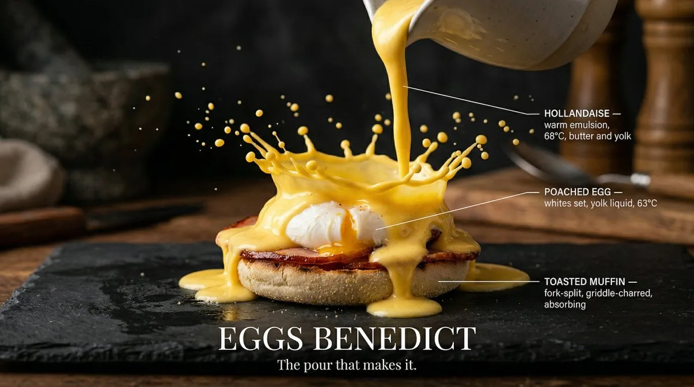

# Alexandra Aisling — by @AllaAisling

[← Back to Community Examples](../../EXAMPLES.md) · Category: Food & Drink · Model: `Nano Banana`

<a href="https://x.com/AllaAisling/status/2037583533674320072"></a>

Source: **[@AllaAisling on X](https://x.com/AllaAisling/status/2037583533674320072)** · Creator: [Alexandra Aisling](https://x.com/AllaAisling)

## Prompt

```text
[DISH] at the precise moment of a dramatic [LIQUID] pour in ultra high-speed photography, liquid cascade frozen mid-fall in perfect clarity. Hero [DISH] center on matte [COLOR] surface, [LIQUID] pouring from above in one cinematic ribbon catching warm single-source light, splitting and branching into suspended droplets and threads as it hits the surface. Splatter crown frozen at moment of impact, droplets suspended in perfect arcs. Every surface texture hyperreal: glistening, steaming, sauce pooling in slow motion. Each element labeled with ultra-thin lines in clean uppercase: "[INGREDIENT] [descriptor]". Dish name in elegant editorial typography: "[DISH NAME]". Subtitle: "[TAGLINE]". Mood: Albert Watson food photography meets Harold Edgerton fluid dynamics meets Michelin-star editorial. 4K, tack sharp every thread and droplet, warm single-source light, extraordinary and craveable.
```

## Try it

Paste the prompt into **[vinano.ai](https://vinano.ai?utm_source=github&utm_medium=readme&utm_campaign=awesome-image-video-prompts-updating&utm_content=x-page-try)** to generate your own version.

> The image and prompt belong to @AllaAisling ([original post](https://x.com/AllaAisling/status/2037583533674320072)) and are shown here with credit for reference. Creators can ask for changes or removal by opening an issue.
