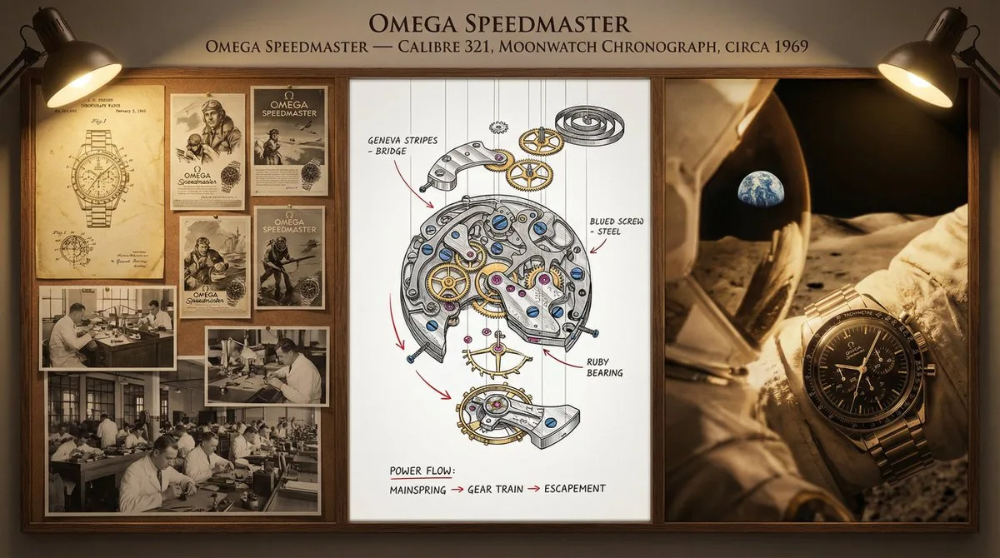

# Alexandra Aisling — by @AllaAisling

[← Back to Community Examples](../../EXAMPLES.md) · Category: Illustration & 3D · Model: `Nano Banana`

<a href="https://x.com/AllaAisling/status/2018374415474438544"></a>

Source: **[@AllaAisling on X](https://x.com/AllaAisling/status/2018374415474438544)** · Creator: [Alexandra Aisling](https://x.com/AllaAisling)

## Prompt

```text
A master watchmaker's documentation board for [TIMEPIECE] — [MANUFACTURE / COMPLICATION / YEAR]. Left section: historical context showing the original patent drawings, period advertisements in gilded frames, and archival photographs of the atelier with craftsmen at work. Center section: the movement in exploded view, every wheel, spring, and jewel suspended in precise spatial relationship, with material callouts (Geneva stripes, blued screws, ruby bearings) and functional annotations tracing the flow of power from mainspring to escapement. Right section: the completed watch in its defining context—wrist of an explorer, pocket of a diplomat, or display case of a collector—captured with shallow depth and warm side lighting. Visual style transitions from sepia patent office to mechanical precision chrome to intimate portraiture. Title block reading "[WATCH NAME] — CALIBRE [NUMBER], [COMPLICATION], CIRCA [YEAR]".
```

## Try it

Paste the prompt into **[vinano.ai](https://vinano.ai?utm_source=github&utm_medium=readme&utm_campaign=awesome-image-video-prompts-updating&utm_content=x-page-try)** to generate your own version.

> The image and prompt belong to @AllaAisling ([original post](https://x.com/AllaAisling/status/2018374415474438544)) and are shown here with credit for reference. Creators can ask for changes or removal by opening an issue.
