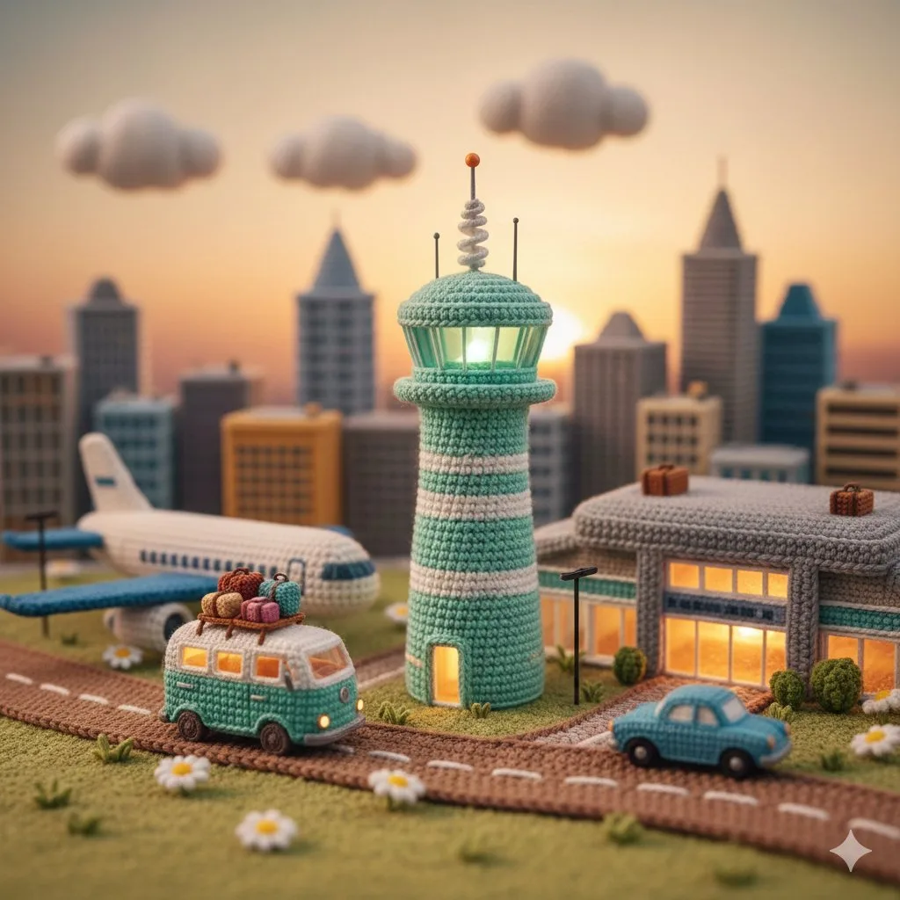

# Sharon Riley — by @Just_sharon7

[← Back to Community Examples](../../EXAMPLES.md) · Category: Illustration & 3D · Model: `Nano Banana`

<a href="https://x.com/Just_sharon7/status/2017994945785643125"></a>

Source: **[@Just_sharon7 on X](https://x.com/Just_sharon7/status/2017994945785643125)** · Creator: [Sharon Riley](https://x.com/Just_sharon7)

## Prompt

```text
A highly detailed miniature diorama entirely made of crochet and amigurumi yarn, whimsical cute style, featuring a tall mint-green crocheted airport control tower with white accents and antenna on top, a small teal crocheted camper van with luggage on roof driving on a crocheted road, tiny crocheted blue classic car, a large crocheted passenger airplane parked near an orange-lit terminal building, crocheted city skyline with tall buildings in the background, sunset sky with soft clouds and golden hour lighting, tiny crocheted daisies and grass patches on the ground, textured yarn stitches visible everywhere, cozy handmade craft aesthetic, soft pastel colors, dreamy warm atmosphere, macro photography style, bokeh background, ultra detailed, cute and charming
```

## Try it

Paste the prompt into **[vinano.ai](https://vinano.ai?utm_source=github&utm_medium=readme&utm_campaign=awesome-image-video-prompts-updating&utm_content=x-page-try)** to generate your own version.

> The image and prompt belong to @Just_sharon7 ([original post](https://x.com/Just_sharon7/status/2017994945785643125)) and are shown here with credit for reference. Creators can ask for changes or removal by opening an issue.
