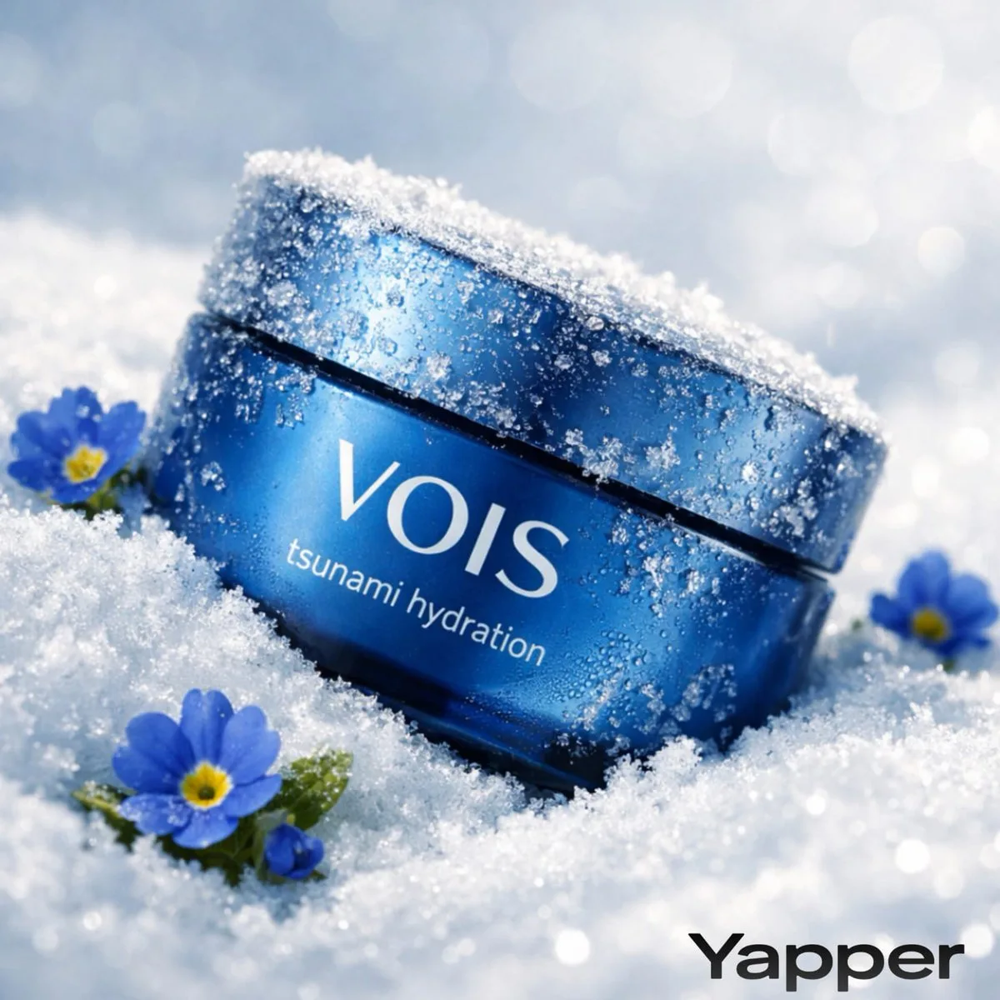

# Meem — by @mehvishs25

[← Back to Community Examples](../../EXAMPLES.md) · Category: Product & Brand · Model: `Nano Banana`

<a href="https://x.com/mehvishs25/status/2033349315763323051"></a>

Source: **[@mehvishs25 on X](https://x.com/mehvishs25/status/2033349315763323051)** · Creator: [Meem](https://x.com/mehvishs25)

## Prompt

```text
{
  "type": "photorealistic skincare product photography",
  "product": {
    "name": "VOIS – tsunami hydration",
    "container": "blue cosmetic cream jar",
    "position": "diagonally placed and partially embedded in fresh white snow",
    "details": "light hoarfrost and frozen condensation crystals on the jar surface"
  },
  "scene": {
    "environment": "soft powdery snow with sparkling ice crystals",
    "elements": "small blue primrose flowers with green leaves scattered around, some partially buried",
    "background": "clean minimal snowy bokeh with cold airy atmosphere"
  },
  "lighting": "bright winter side sunlight creating crisp highlights and soft natural shadows",
  "camera": {
    "lens": "85mm macro",
    "aperture": "f/2.8",
    "iso": 100,
    "depth_of_field": "shallow"
  },
  "style": "premium commercial skincare advertisement, cinematic macro composition",
  "quality": "ultra-detailed, photorealistic, 8K",
  "constraints": ["no people", "no text overlays", "minimal background"]
}
```

## Try it

Paste the prompt into **[vinano.ai](https://vinano.ai?utm_source=github&utm_medium=readme&utm_campaign=awesome-image-video-prompts-updating&utm_content=x-page-try)** to generate your own version.

> The image and prompt belong to @mehvishs25 ([original post](https://x.com/mehvishs25/status/2033349315763323051)) and are shown here with credit for reference. Creators can ask for changes or removal by opening an issue.
