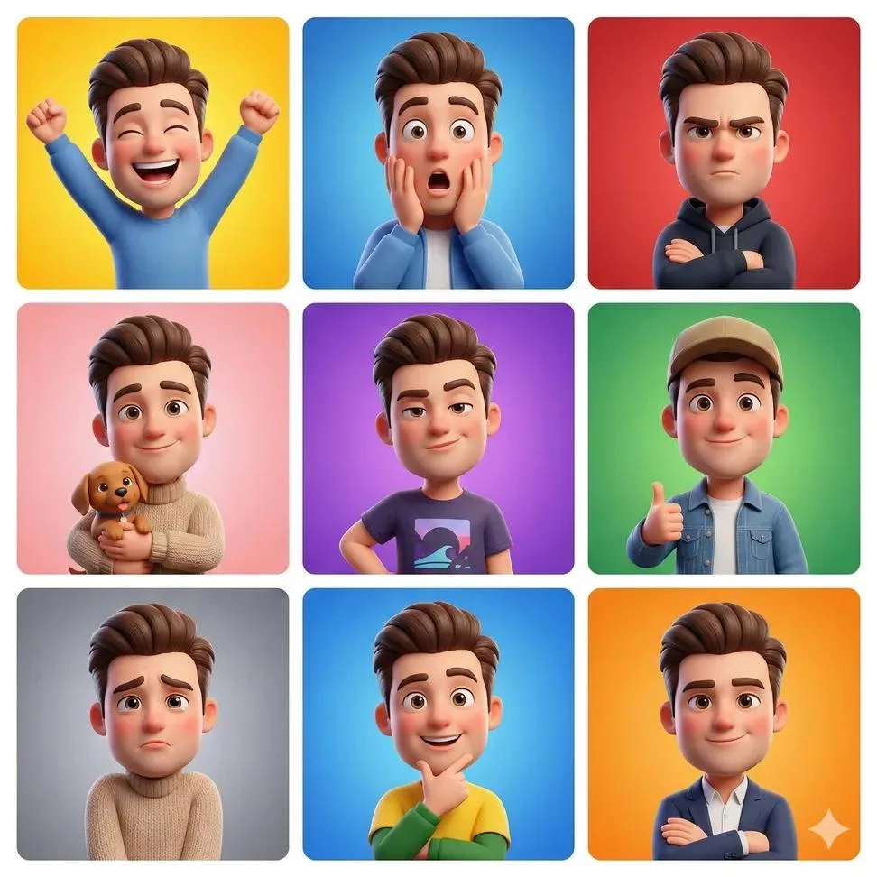

# Taaruk — by @Taaruk_

[← Back to Community Examples](../../EXAMPLES.md) · Category: Illustration & 3D · Model: `Nano Banana`

<a href="https://x.com/Taaruk_/status/2029204838945570982"></a>

Source: **[@Taaruk_ on X](https://x.com/Taaruk_/status/2029204838945570982)** · Creator: [Taaruk](https://x.com/Taaruk_)

## Prompt

```text
3D cartoon avatar character showing different emotions arranged in a 3x3 grid, same male character with brown hair, Pixar-style animation, each square showing a different expression (happy, shocked, angry, caring with a puppy, confident, thumbs up, sad, thinking, professional), colorful gradient backgrounds for each panel, soft studio lighting, smooth 3D rendering, expressive eyes and facial expressions, modern emoji-style character design, clean composition, ultra-detailed, vibrant colors, 8K.
```

## Try it

Paste the prompt into **[vinano.ai](https://vinano.ai?utm_source=github&utm_medium=readme&utm_campaign=awesome-image-video-prompts-updating&utm_content=x-page-try)** to generate your own version.

> The image and prompt belong to @Taaruk_ ([original post](https://x.com/Taaruk_/status/2029204838945570982)) and are shown here with credit for reference. Creators can ask for changes or removal by opening an issue.
