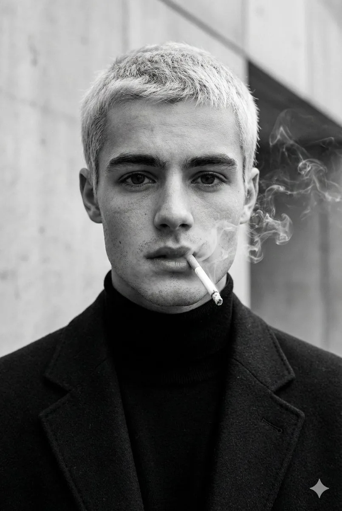

# Harboriis — by @harboriis

[← Back to Community Examples](../../EXAMPLES.md) · Category: Photography · Model: `Nano Banana`

<a href="https://x.com/harboriis/status/2017795656379994165"></a>

Source: **[@harboriis on X](https://x.com/harboriis/status/2017795656379994165)** · Creator: [Harboriis](https://x.com/harboriis)

## Prompt

```text
Ultra-realistic fashion black and white portrait of a man with short light hair, wearing a dark tailored coat and a black turtleneck. They hold a cigarette between their lips as soft smoke curls around their face. Extremely detailed natural skin texture visible pores, fine lines, realistic contrast and tonal range. lifelike matte highlights. Subtle film grain, soft diffused lighting, minimalist background. High-fashion editorial mood, sharp details, expressive gaze, dramatic monochrome aesthetic, Hasselblad X2D, 30mm lens, strong contrast, daylight, fashion composition, architectural elements, editorial clarity medium format -p cz2pqao
```

## Try it

Paste the prompt into **[vinano.ai](https://vinano.ai?utm_source=github&utm_medium=readme&utm_campaign=awesome-image-video-prompts-updating&utm_content=x-page-try)** to generate your own version.

> The image and prompt belong to @harboriis ([original post](https://x.com/harboriis/status/2017795656379994165)) and are shown here with credit for reference. Creators can ask for changes or removal by opening an issue.
