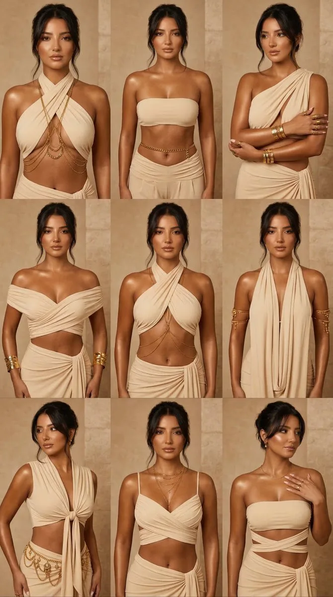

# Özge Döner — by @astronomerozge1

[← Back to Community Examples](../../EXAMPLES.md) · Category: Photography · Model: `Nano Banana`

<a href="https://x.com/astronomerozge1/status/2031462324821741847"></a>

Source: **[@astronomerozge1 on X](https://x.com/astronomerozge1/status/2031462324821741847)** · Creator: [Özge Döner](https://x.com/astronomerozge1)

## Prompt

```text
{
  "generation_request": {
    "meta_data": {
      "tool": "NanoBanana Pro",
      "task_type": "fashion_variation_grid_9panel",
      "language": "en",
      "priority": "highest",
      "version": "v1.0_GOLDEN_GODDESS_JEWELRY_9GRID"
    },
    "input": {
      "mode": "text_to_image",
      "notes": "Create a 3x3 high-fashion goddess editorial grid featuring the same elegant woman with luxurious gold body jewelry and draped styling."
    },
    "output_settings": {
      "aspect_ratio": "4:5",
      "orientation": "portrait",
      "resolution_target": "ultra_high_res",
      "num_images": 1,
      "layout": {
        "type": "grid",
        "rows": 3,
        "cols": 3,
        "gutter": "thin",
        "outer_border": "none",
        "panel_consistency": "very_high"
      },
      "render_style": "golden_goddess_editorial",
      "sharpness": "editorial_crisp",
      "grain": "subtle_clean"
    },
    "scene": {
      "environment": "warm sand-toned luxury studio with subtle stone texture",
      "lighting": "golden diffused light with bronzed highlights on skin and jewelry",
      "mood": "divine, radiant, regal, sensual"
    },
    "subject": {
      "description": "same elegant adult woman across all 9 panels",
      "face": "same identity in all panels, calm regal expression",
      "skin": "sunlit bronzed luminous skin texture",
      "hair": "soft dark hair styled loosely back with glowing face-framing strands",
      "makeup": "gold-bronze eyelids, subtle liner, luminous skin, glossy nude lips",
      "expression": "serene, elevated, goddess-like"
    },
    "wardrobe": {
      "top": "soft ivory or sand draped wrap tops with goddess-inspired constructions",
      "bottom": "flowing low-rise draped bottoms",
      "accessories": "dramatic gold cuff bracelets, layered gold body chains, gold waist jewelry, delicate rings",
      "styling": "ancient goddess meets modern couture"
    },
    "composition_rules": {
      "face_visibility": "mandatory in all 9 panels",
      "framing": "mid-length to upper-thigh framing",
      "identity_consistency": "same woman in every panel"
    },
    "panel_design": {
      "panel_1": "front portrait with crossed halter drape and gold chest jewelry",
      "panel_2": "front portrait with bandeau drape and gold waist chain",
      "panel_3": "three-quarter portrait with one-shoulder drape and layered gold accessories",
      "panel_4": "front portrait with off-shoulder draped wrap and stacked gold cuffs",
      "panel_5": "front portrait with sculptural crossed neckline and gold body chain",
      "panel_6": "front portrait with elongated halter drape and arm jewelry",
      "panel_7": "three-quarter portrait with tied-front drape and ornate waist chain",
      "panel_8": "front portrait with diagonal wrapped bust and gold accents",
      "panel_9": "front portrait with bandeau and crisscross waist drape, hand touching collarbone"
    },
    "camera": {
      "lens": "85mm portrait lens",
      "style": "luxury goddess fashion photography",
      "depth_of_field": "shallow",
      "angle": "eye-level"
    },
    "quality_control": {
      "identity_consistency": "maximum",
      "panel_consistency": "very_high",
      "face_priority": "absolute",
      "anatomy_accuracy": "maximum",
      "hands_priority": "very_high",
      "jewelry_integrity": "very_high",
      "fabric_realism": "high"
    },
    "negative_prompt": [
      "cheap costume jewelry",
      "different woman",
      "extra fingers",
      "missing fingers",
      "warped anatomy",
      "plastic skin",
      "text",
      "watermark",
      "logo"
    ]
  }
}
```

## Try it

Paste the prompt into **[vinano.ai](https://vinano.ai?utm_source=github&utm_medium=readme&utm_campaign=awesome-image-video-prompts-updating&utm_content=x-page-try)** to generate your own version.

> The image and prompt belong to @astronomerozge1 ([original post](https://x.com/astronomerozge1/status/2031462324821741847)) and are shown here with credit for reference. Creators can ask for changes or removal by opening an issue.
