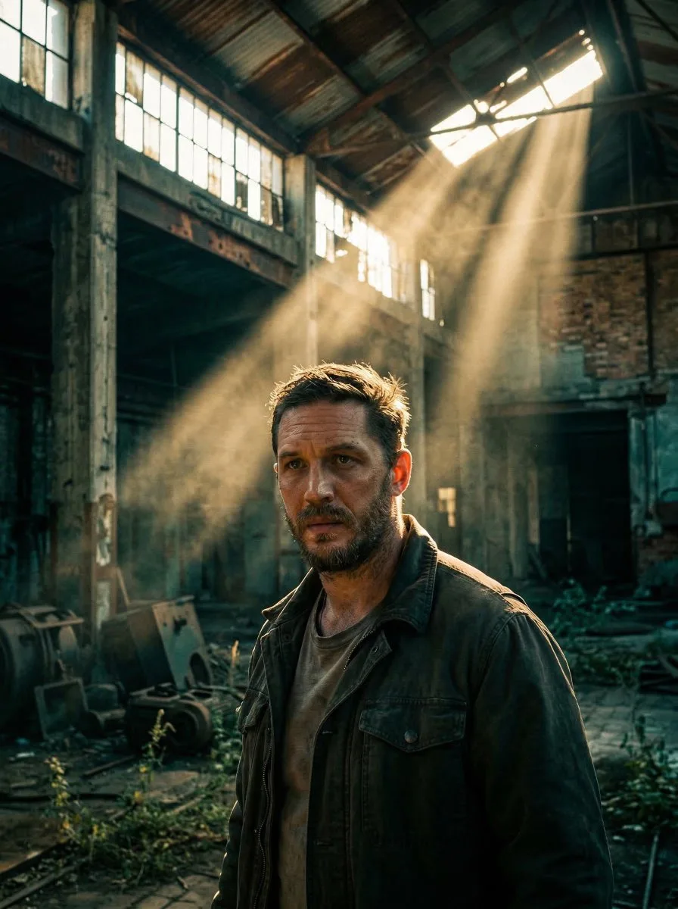

# Nikhil — by @NikhilRajX

[← Back to Community Examples](../../EXAMPLES.md) · Category: Photography · Model: `Nano Banana`

<a href="https://x.com/NikhilRajX/status/2032013831548125557"></a>

Source: **[@NikhilRajX on X](https://x.com/NikhilRajX/status/2032013831548125557)** · Creator: [Nikhil](https://x.com/NikhilRajX)

## Prompt

```text
Portrait of [your description], face illuminated by dramatic cinematic volumetric god rays, intense shafts of golden light beams cutting through dusty abandoned warehouse, sunlight streaming through broken high windows and cracked roof, floating dust particles and haze making light visible, strong rim light and backlighting, moody high-contrast atmosphere, industrial concrete pillars and rusted metal in background, film still, epic cinematic lighting, volumetric fog, god rays, atmospheric depth, ultra-detailed skin texture, shallow depth of field, shot on 35mm Arri Alexa, cinematic color grade, teal shadows and warm golden highlights --ar 3:4 --stylize 250 --v 6 --q 2
```

## Try it

Paste the prompt into **[vinano.ai](https://vinano.ai?utm_source=github&utm_medium=readme&utm_campaign=awesome-image-video-prompts-updating&utm_content=x-page-try)** to generate your own version.

> The image and prompt belong to @NikhilRajX ([original post](https://x.com/NikhilRajX/status/2032013831548125557)) and are shown here with credit for reference. Creators can ask for changes or removal by opening an issue.
