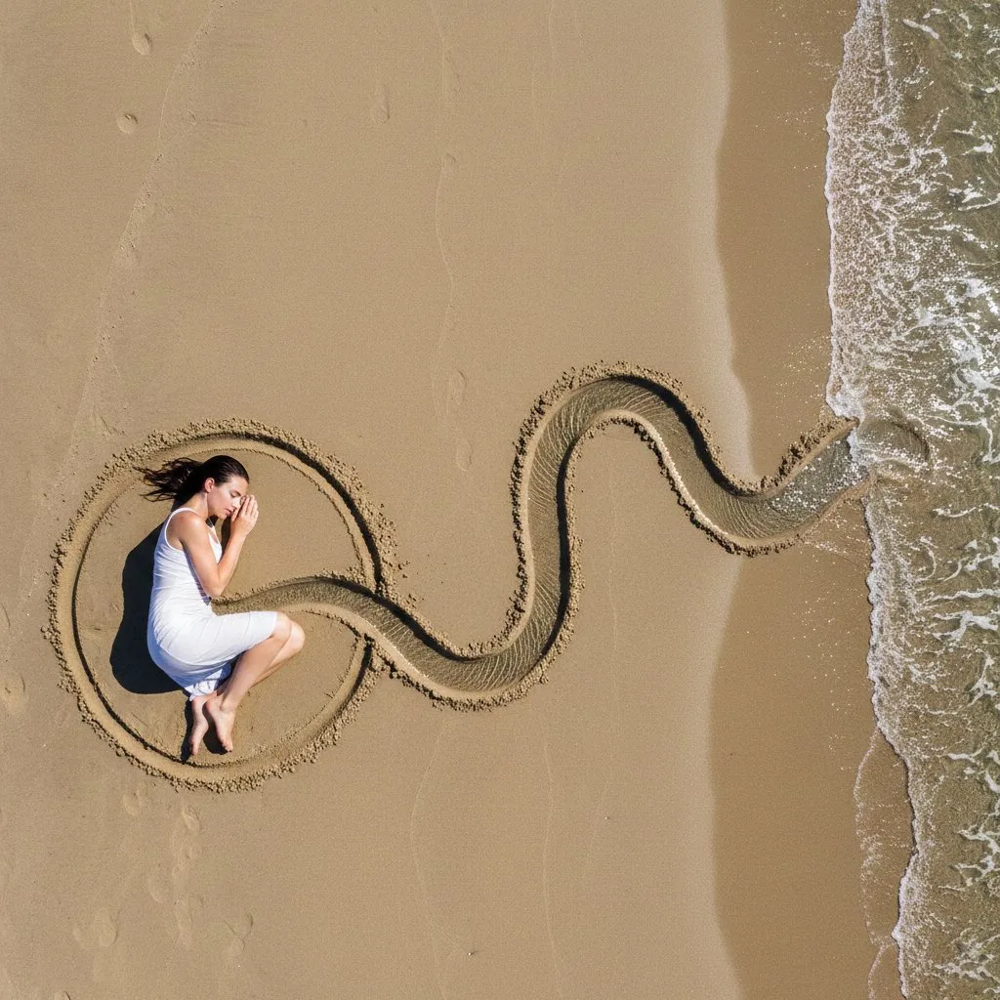

# Emily — by @IamEmily2050

[← Back to Community Examples](../../EXAMPLES.md) · Category: Photography · Model: `Nano Banana`

<a href="https://x.com/IamEmily2050/status/2024545041193324550"></a>

Source: **[@IamEmily2050 on X](https://x.com/IamEmily2050/status/2024545041193324550)** · Creator: [Emily](https://x.com/IamEmily2050)

## Prompt

```text
{
  "intent": {
    "summary": "Land-art photography of a woman connected to the sea via a specific water-filled trench in the sand, matching a provided schematic diagram.",
    "strategy": "Structural Precision: Defining the 'line' as a dug channel to prevent chaotic water flow."
  },
  "frame": {
    "aspect_ratio": "3:2",
    "shot_size": "Wide Shot (WS)",
    "orientation": "Landscape",
    "composition_guide": "Diagrammatic Layout: Woman on left, Sea on right, connected by a sinuous line."
  },
  "subject": {
    "subject_type": "Human",
    "identity_summary": "Female figure acting as the anchor for a sand-art installation.",
    "visual_signature": {
      "facial_signature": {
        "face_shape": "Soft",
        "eye_details": "Closed",
        "nose_details": "Natural",
        "lip_details": "Relaxed",
        "cheek_and_jaw": "Relaxed",
        "unique_features": "Wet hair"
      },
      "body_signature": {
        "build": "Slender",
        "proportions": "Natural",
        "skin_tone_and_texture": "Natural, sand-dusted",
        "height_estimation_cm": 165,
        "unique_markings": "None"
      }
    },
    "pose_and_action": {
      "description": "Lying in a tight fetal position inside a sand circle.",
      "body_position": "Curled on side, knees tucked high.",
      "limb_positions": "Arms tucked in, hugging knees.",
      "hand_gestures": "Hands folded near face/knees.",
      "facial_expression": "Peaceful, sleeping.",
      "gaze_direction": "Eyes closed."
    },
    "inventory": {
      "wardrobe": "White dress, wet and clinging to the body.",
      "accessories": "None.",
      "held_objects": "None.",
      "hair_style": "Dark, wet, splayed out on the sand."
    }
  },
  "environment": {
    "setting_type": "Outdoor",
    "location_description": "Flat sandy beach with specific sand-art markings.",
    "time_of_day": "Daytime",
    "weather_conditions": "Clear",
    "background_elements": "The beach features a deep, hand-dug trench snaking from the sea to the woman's belly. This trench is filled with sea water but distinct from the surrounding dry sand. A separate circular groove surrounds the woman."
  },
  "lighting": {
    "global_illumination": "Natural Sunlight",
    "primary_source": "Sun",
    "direction": "Top-down",
    "shadow_quality": "Sharp shadows inside the dug sand trenches to emphasize depth.",
    "color_temperature": "Daylight (5500k)"
  },
  "camera": {
    "angle": "Bird's Eye View",
    "lens_type": "35mm Wide Angle",
    "focal_length_mm": 35,
    "aperture": "f/8 (Deep focus to keep the entire sand drawing sharp)"
  },
  "post_processing": {
    "art_medium": "Photography",
    "style_modifiers": "Land Art, Conceptual, National Geographic",
    "color_grade": "Natural tones, high contrast between water in the trench and the sand.",
    "rendering_engine": "N/A",
    "quality_boosters": "8k, sharp focus, hyper-realistic water texture"
  },
  "negative": {
    "artifact_suppression": "waves washing over subject, messy water, flooding, broken lines, chaotic splash, surfing",
    "subject_excludes": "standing, dry sand, rocks"
  }
}
```

## Try it

Paste the prompt into **[vinano.ai](https://vinano.ai?utm_source=github&utm_medium=readme&utm_campaign=awesome-image-video-prompts-updating&utm_content=x-page-try)** to generate your own version.

> The image and prompt belong to @IamEmily2050 ([original post](https://x.com/IamEmily2050/status/2024545041193324550)) and are shown here with credit for reference. Creators can ask for changes or removal by opening an issue.
