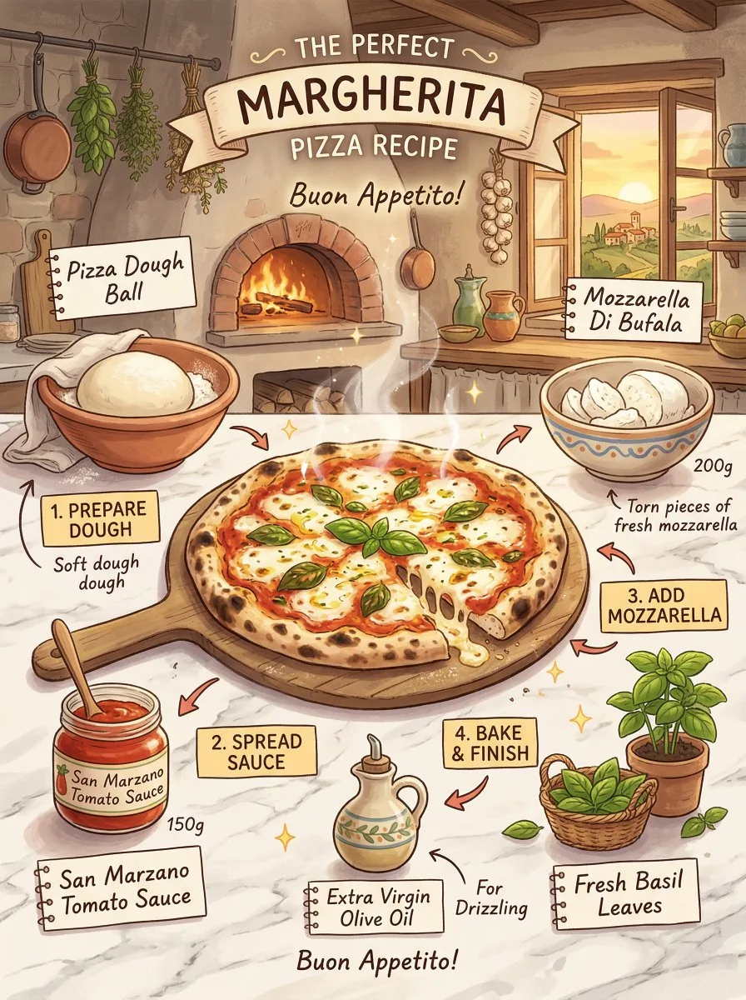

# Amira Zairi — by @azed_ai

[← Back to Examples from X](../../EXAMPLES.md) · Category: Food & Drink · Model: `Nano Banana`

<a href="https://x.com/azed_ai/status/2027140890247246017"></a>

Original post: **[@azed_ai on X](https://x.com/azed_ai/status/2027140890247246017)** · Creator: [Amira Zairi](https://x.com/azed_ai)

## Prompt

```text
margherita pizza recipe infographic, Studio Ghibli inspired illustration, traditional Italian kitchen setting, warm golden sunset light, whole pizza in center with bubbling cheese, ingredients illustrated around in cute containers, dough ball, tomato sauce 150g, mozzarella 200g, fresh basil leaves, olive oil drizzle, handwritten notebook style labels, soft pastel tones, painterly textures, gentle steam and magical glow, whimsical cozy feeling, clean organized layout, readable text, high detail
```

## Try it

Paste the prompt into **[vinano.ai](https://vinano.ai?utm_source=github&utm_medium=readme&utm_campaign=awesome-image-video-prompts-updating&utm_content=x-page-try)** to generate your own version.

> The image and prompt belong to [@azed_ai](https://x.com/azed_ai) and are shown here with credit for reference. Creators can ask for changes or removal by opening an issue.
