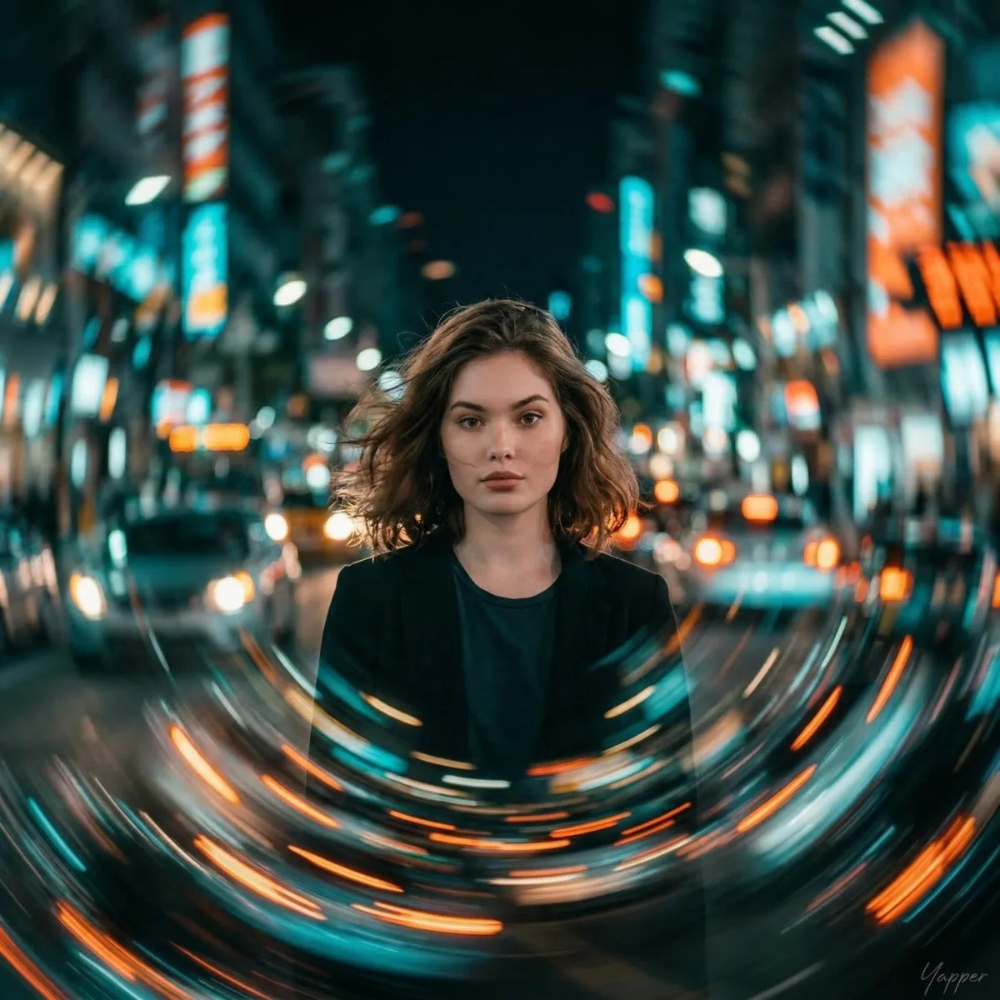

# Anissa — by @SimplyAnnisa

[← Back to Examples from X](../../EXAMPLES.md) · Category: Photography · Model: `Nano Banana`

<a href="https://x.com/SimplyAnnisa/status/2032694954758193192"></a>

Original post: **[@SimplyAnnisa on X](https://x.com/SimplyAnnisa/status/2032694954758193192)** · Creator: [Anissa](https://x.com/SimplyAnnisa)

## Prompt

```text
cinematic portrait of a young woman standing perfectly still as the city around her spirals in circular motion blur, streaks of headlights and neon lights orbiting her body like gravity pulling the world inward, dramatic teal and orange cinematic color grading, wind moving strands of hair, calm expression contrasting chaotic motion, shallow depth of field, shot on a 50mm lens, realistic skin texture, atmospheric night lighting, vertical composition
```

## Try it

Paste the prompt into **[vinano.ai](https://vinano.ai?utm_source=github&utm_medium=readme&utm_campaign=awesome-image-video-prompts-updating&utm_content=x-page-try)** to generate your own version.

> The image and prompt belong to [@SimplyAnnisa](https://x.com/SimplyAnnisa) and are shown here with credit for reference. Creators can ask for changes or removal by opening an issue.
