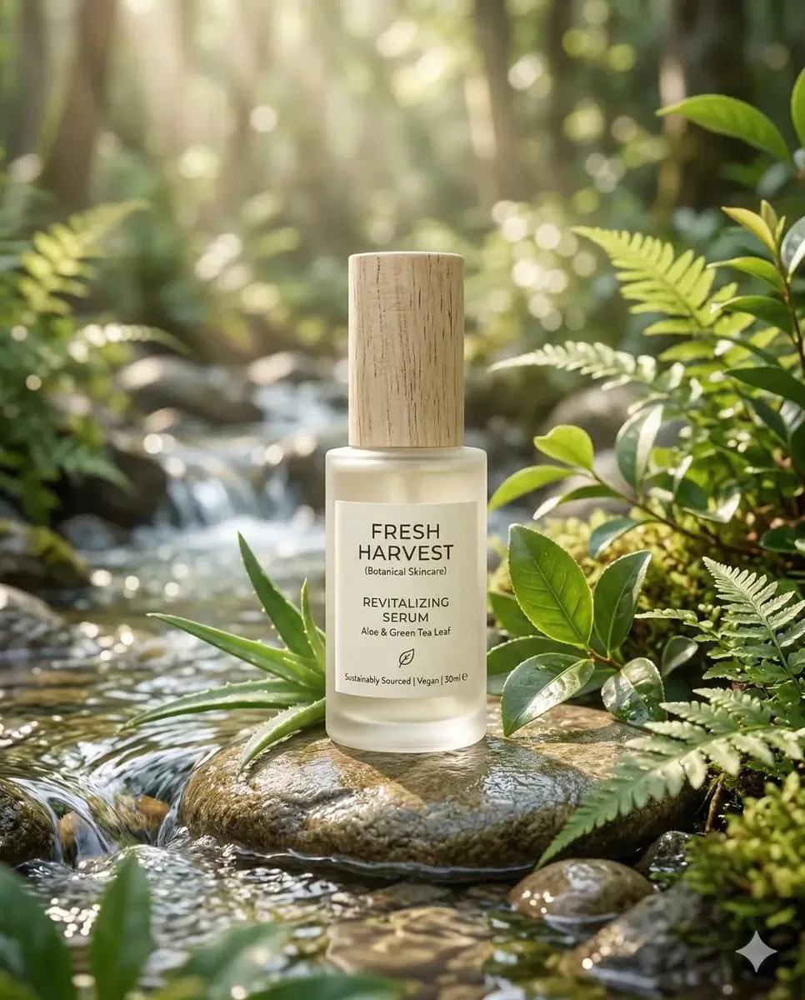

# Oogie — by @oggii_0

[← Back to Community Examples](../../EXAMPLES.md) · Category: Product & Brand · Model: `Nano Banana`

<a href="https://x.com/oggii_0/status/2035582838649827509"></a>

Source: **[@oggii_0 on X](https://x.com/oggii_0/status/2035582838649827509)** · Creator: [Oogie](https://x.com/oggii_0)

## Prompt

```text
Eco-Friendly Skincare Product “Minimalist skincare bottle made of frosted glass, placed in a serene natural setting with flowing water, green leaves, and soft sunlight rays, clean aesthetic inspired by The Body Shop, sustainability-focused branding, soft pastel tones, high-end product photography, calm and pure atmosphere”
```

## Try it

Paste the prompt into **[vinano.ai](https://vinano.ai?utm_source=github&utm_medium=readme&utm_campaign=awesome-image-video-prompts-updating&utm_content=x-page-try)** to generate your own version.

> The image and prompt belong to @oggii_0 ([original post](https://x.com/oggii_0/status/2035582838649827509)) and are shown here with credit for reference. Creators can ask for changes or removal by opening an issue.
