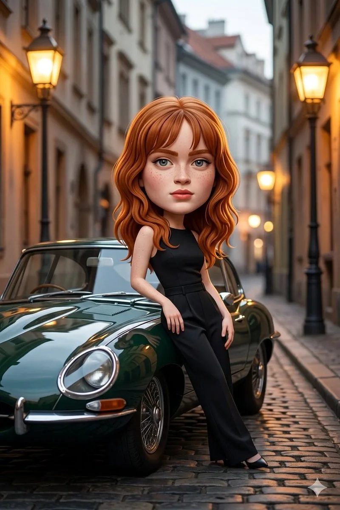

# Synthia — by @AIwithSynthia

[← Back to Community Examples](../../EXAMPLES.md) · Category: Illustration & 3D · Model: `Nano Banana`

<a href="https://x.com/AIwithSynthia/status/2038172237560439254"></a>

Source: **[@AIwithSynthia on X](https://x.com/AIwithSynthia/status/2038172237560439254)** · Creator: [Synthia](https://x.com/AIwithSynthia)

## Prompt

```text
Use the uploaded image as the primary subject reference. Transform the person into a stylized caricature with a slightly oversized head and a smaller body while preserving facial identity, expression, hairstyle, and key features.
Place the subject casually leaning against a vintage dark green classic car on a narrow cobblestone street with warm glowing street lamps on both sides. Maintain a relaxed, confident pose.
Outfit should match or naturally enhance the original clothing from the uploaded image (adapt if needed to fit the scene). Keep textures realistic and well-detailed.
Style: 3D cartoon realism, cinematic lighting, shallow depth of field, ultra-detailed, soft shadows, warm tones, high resolution, vibrant but natural colors.
```

## Try it

Paste the prompt into **[vinano.ai](https://vinano.ai?utm_source=github&utm_medium=readme&utm_campaign=awesome-image-video-prompts-updating&utm_content=x-page-try)** to generate your own version.

> The image and prompt belong to @AIwithSynthia ([original post](https://x.com/AIwithSynthia/status/2038172237560439254)) and are shown here with credit for reference. Creators can ask for changes or removal by opening an issue.
