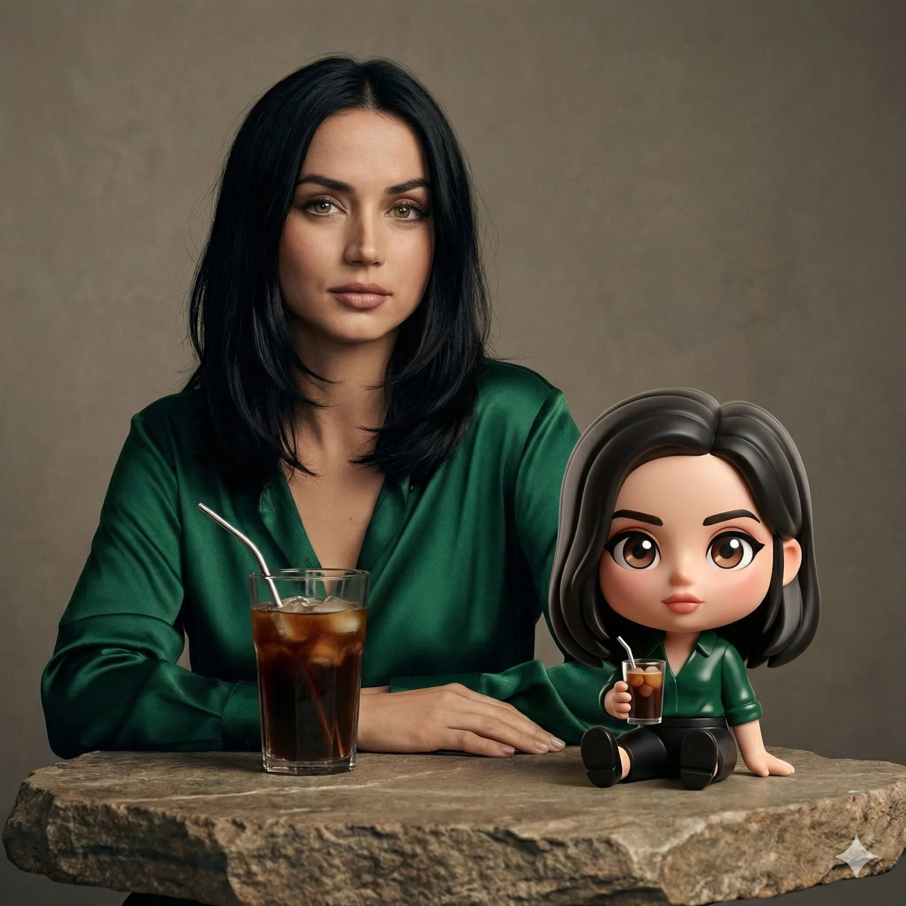

# Johnn — by @john_my07

[← Back to Examples from X](../../EXAMPLES.md) · Category: Illustration & 3D · Model: `Nano Banana`

<a href="https://x.com/john_my07/status/2010264538562867271"></a>

Original post: **[@john_my07 on X](https://x.com/john_my07/status/2010264538562867271)** · Creator: [Johnn](https://x.com/john_my07)

## Prompt

```text
{
  "aspect_ratio": "1:1",
  "scene_type": "cinematic_studio_portrait",
  "environment": {
    "background_color": "warm_muted_gray",
    "surface": "natural_textured_stone_table",
    "mood": "intimate_evening_cafe",
    "atmosphere": "cozy_moody"
  },
  "primary_subject": {
    "identity": "Ana de Armas",
    "pose": "seated_relaxed",
    "expression": "soft_calm_confident",
    "appearance": {
      "hair": "black_shoulder_length_soft_layers",
      "makeup": "subtle_evening_makeup",
      "outfit": "dark_brown_satin_blouse"
    },
    "focus": "sharp_subject_isolation"
  },
  "props": {
    "main_drink": {
      "type": "cold_brew_coffee",
      "glass": "clear_glass_with_ice",
      "straw": "metal_straw"
    },
    "stylized_figure": {
      "style": "high_quality_3d_chibi_collectible",
      "design": {
        "head": "oversized_rounded",
        "eyes": "large_expressive",
        "cheeks": "soft_blush",
        "features": "simplified_cute"
      },
      "likeness": "same_as_primary_subject",
      "pose": "holding_miniature_cold_brew_glass",
      "material": "glossy_with_soft_reflections"
    }
  },
  "lighting": {
    "type": "soft_cinematic",
    "direction": "angled_key_with_gentle_falloff",
    "highlights": "subtle_reflections_on_glass_and_chibi",
    "shadows": "smooth_and_moody"
  },
  "camera": {
    "depth_of_field": "shallow",
    "focus_priority": "real_subject_then_chibi",
    "look": "cinematic_photography"
  },
  "style_notes": [
    "realistic_human_combined_with_stylized_3d_character",
    "premium_collectible_toy_aesthetic",
    "warm_color_grading",
    "cozy_evening_tone",
    "ultra_detailed",
    "photoreal_subject"
  ]
}
```

## Try it

Paste the prompt into **[vinano.ai](https://vinano.ai?utm_source=github&utm_medium=readme&utm_campaign=awesome-image-video-prompts-updating&utm_content=x-page-try)** to generate your own version.

> The image and prompt belong to [@john_my07](https://x.com/john_my07) and are shown here with credit for reference. Creators can ask for changes or removal by opening an issue.
