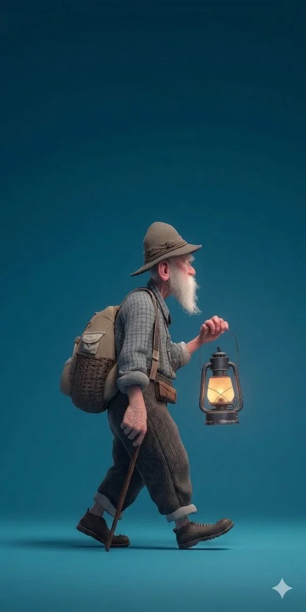

# auqib — by @auqibhabib

[← Back to Examples from X](../../EXAMPLES.md) · Category: Illustration & 3D · Model: `Nano Banana`

<a href="https://x.com/auqibhabib/status/2044357243827580959"></a>

Original post: **[@auqibhabib on X](https://x.com/auqibhabib/status/2044357243827580959)** · Creator: [auqib](https://x.com/auqibhabib)

## Prompt

```text
​A stylized 3D rendered full-body profile portrait of an elderly male hiker with a long white beard, viewed from the side and walking from left to right. He is set against a solid, seamless deep-teal studio background with soft floor reflections. He wears a brown felt wide-brimmed hiker's hat, a gray and blue plaid shirt over cuffed brown corduroy trousers, and dark, scuffed work boots. On his back is a large, detailed combination canvas and woven wicker backpack with leather straps. He holds a lit, vintage brass-and-glass hurricane lantern in his right hand, which casts a warm, soft glow. He also carries a simple wooden walking stick. The image has a textured, matte finish and soft, diffused studio lighting, with the vertical composition leaving ample negative space.
```

## Try it

Paste the prompt into **[vinano.ai](https://vinano.ai?utm_source=github&utm_medium=readme&utm_campaign=awesome-image-video-prompts-updating&utm_content=x-page-try)** to generate your own version.

> The image and prompt belong to [@auqibhabib](https://x.com/auqibhabib) and are shown here with credit for reference. Creators can ask for changes or removal by opening an issue.
