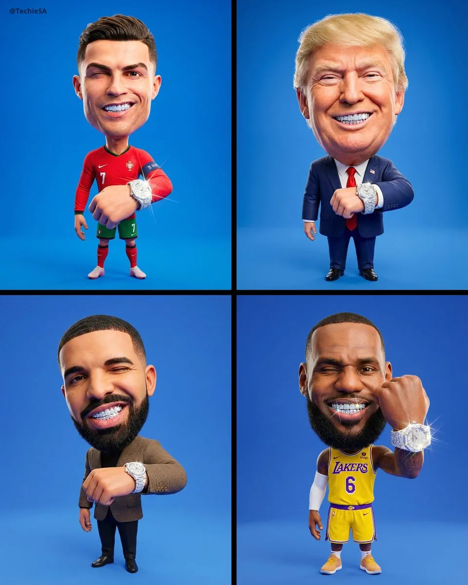

# TechieSA — by @TechieBySA

[← Back to Community Examples](../../EXAMPLES.md) · Category: Illustration & 3D · Model: `Nano Banana`

<a href="https://x.com/TechieBySA/status/2027380851030262216"></a>

Source: **[@TechieBySA on X](https://x.com/TechieBySA/status/2027380851030262216)** · Creator: [TechieSA](https://x.com/TechieBySA)

## Prompt

```text
Maintain the exact same person and facial identity from the reference photo. Detailed 3D Caricature Prompt:
A professional, ultra-detailed full-body 3D stylized caricature portrait of the person from [REFERENCE IMAGE], standing in a confident upright pose.
ANATOMY & PROPORTIONS: Extremely exaggerated silhouette featuring a massive, oversized head with a large-scale ratio compared to a tiny, diminutive, and short body. The neck is short and thick to support the giant head. Maintain the subject’s exact facial identity, skin tone, and ethnic features from [REFERENCE IMAGE], but with intentional caricature deformation. The character has a mischievous, confident expression, giving a playful wink toward the lens with one eye. A wide smirk reveals a full set of meticulously detailed, sparkling diamond grillz (teeth) that catch and refract the light.
POSE & JEWELRY: The character is standing still but with a dynamic arm gesture; one arm is brought forward, close to the camera lens, to prominently showcase a thick, heavy, iced-out diamond watch on the wrist. Each individual diamond stone on the watch and the grillz is rendered with ray-traced reflections, creating sharp prismatic glints and brilliant sparkles.
CLOTHING & TEXTURES: The character is wearing the exact same outfit, jewelry, and accessories as seen in [REFERENCE IMAGE]. Fabrics (cotton, silk, or denim) are rendered with high-fidelity microscopic textures, showing realistic folds and stitching on a miniature scale. Skin is rendered with premium subsurface scattering, appearing smooth, clean, and studio-perfect, avoiding any blemishes, noise, or grain.
ENVIRONMENT & LIGHTING: Set against a perfectly clean, seamless, solid vibrant blue studio backdrop with no gradients and no distractions. The lighting is a high-end neutral studio setup using softboxes to provide even, bright illumination across the entire figure. Strictly NO backlighting and NO rim light. Focus on soft, diffused front shadows that define the character’s shape. High-intensity light hits the diamonds to ensure they are the brightest points of the image.
TECHNICAL SPECS: Hyper-realistic 3D render, cinematic quality, Octane Render style, 8k resolution, ultra-high definition, sharp focus, clean edges, masterpiece level, no text, no watermarks, no logos, aspect ratio 4:5.
```

## Try it

Paste the prompt into **[vinano.ai](https://vinano.ai?utm_source=github&utm_medium=readme&utm_campaign=awesome-image-video-prompts-updating&utm_content=x-page-try)** to generate your own version.

> The image and prompt belong to @TechieBySA ([original post](https://x.com/TechieBySA/status/2027380851030262216)) and are shown here with credit for reference. Creators can ask for changes or removal by opening an issue.
