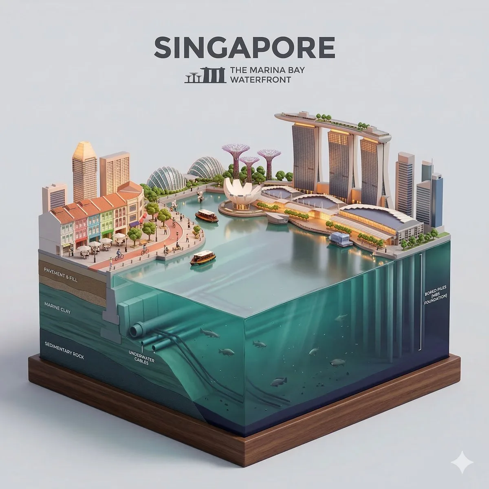

# 两斤 — by @0x00_Krypt

[← Back to Examples from X](../../EXAMPLES.md) · Category: Illustration & 3D · Model: `Nano Banana`

<a href="https://x.com/0x00_Krypt/status/2033888375619637274"></a>

Original post: **[@0x00_Krypt on X](https://x.com/0x00_Krypt/status/2033888375619637274)** · Creator: [两斤](https://x.com/0x00_Krypt)

## Prompt

```text
Present a clear, side-facing isometric miniature 3D cartoon diorama of [CITY] along the [WATERFRONT]. The scene is a clean vertical cross-section slice — the city is cut open like a museum specimen, mounted on a small raised diorama-style base that exposes the full stratigraphy from rooftop to riverbed.

Above the waterline: a curated selection of [CITY]'s most iconic waterfront elements — layered building facades in local architectural style, embankment promenade, bridges, trams or cyclists, warm soft ambient lighting. Tiny stylized figures of residents in casual attire — walking, cycling, sitting at waterfront cafés (no facial details).

The water surface is a clean glassy horizontal band — cartoon-stylized, slightly transparent, acting as the visual threshold between the two worlds.

Below the waterline: the geographically honest submerged anatomy of [CITY]'s [WATERFRONT] — accurate foundation and piling types, real underwater infrastructure, sediment and substrate layers appropriate to this specific body of water, local aquatic life rendered in the same soft cartoon style. Tiny stylized fish, slow-drifting particulate, refracted light shafts filtering down from the surface.

The cross-section cut edge is razor-clean — pavement strata, foundations, soil layers, and underwater geology all simultaneously visible in the base wall, like a natural history diorama exhibit.

Style: soft refined textures, realistic PBR materials, immersive ambient lighting. Color language: warm amber and golden tones above the waterline, cold teal-green and deep indigo below, blending at the water threshold. Ultra-clean, high-clarity 3D cartoon diorama aesthetic.

Use a clean solid [BACKGROUND COLOR] background. At the top-center, display "[CITY]" in large bold text, and place the waterfront name or a city landmark silhouette emblem below the text. All text must automatically match background contrast.

Composition: perfectly centered layout, square 1080x1080.
```

## Try it

Paste the prompt into **[vinano.ai](https://vinano.ai?utm_source=github&utm_medium=readme&utm_campaign=awesome-image-video-prompts-updating&utm_content=x-page-try)** to generate your own version.

> The image and prompt belong to [@0x00_Krypt](https://x.com/0x00_Krypt) and are shown here with credit for reference. Creators can ask for changes or removal by opening an issue.
