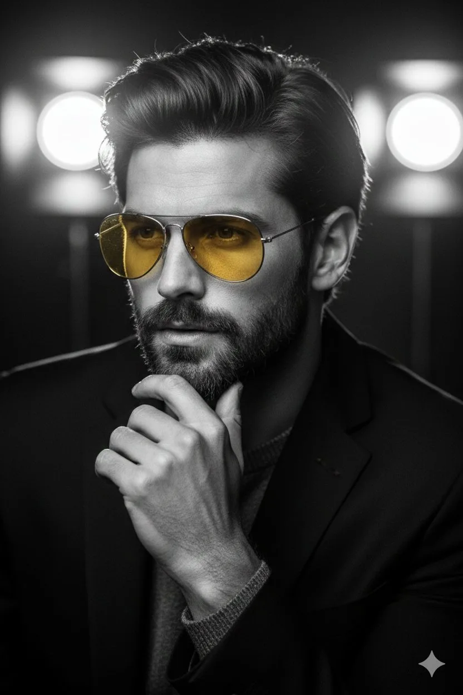

# Taaruk — by @Taaruk_

[← Back to Examples from X](../../EXAMPLES.md) · Category: Photography · Model: `Nano Banana`

<a href="https://x.com/Taaruk_/status/2010724643737686242"></a>

Original post: **[@Taaruk_ on X](https://x.com/Taaruk_/status/2010724643737686242)** · Creator: [Taaruk](https://x.com/Taaruk_)

## Prompt

```text
{
  "Objective": "Create a dramatic black-and-white cinematic portrait with a classic film-noir mood and selective color emphasis",
  "PersonaDetails": {
    "Subject": {
      "Type": "Young man",
      "Hair": "Medium-length, naturally styled",
      "FacialHair": "Well-groomed beard",
      "Pose": "Thoughtful pose with one hand resting near the chin",
      "Expression": "Introspective, confident, composed",
      "Wardrobe": "Dark jacket",
      "Accessories": {
        "Sunglasses": {
          "Type": "Stylish aviator sunglasses",
          "LensColor": "Warm amber/yellow-tinted lenses",
          "SpecialTreatment": "Only colored element in an otherwise monochrome image"
        }
      }
    }
  },
  "Composition": {
    "Framing": "Close-up to mid-close portrait",
    "Angle": "Eye-level, slightly cinematic framing",
    "DepthOfField": "Shallow depth of field",
    "Focus": "Sharp focus on facial features and sunglasses"
  },
  "LightingAndAtmosphere": {
    "LightingStyle": "Strong cinematic backlighting",
    "Effects": [
      "Glowing bokeh lights in the background",
      "Studio or stage-light appearance"
    ],
    "Contrast": "High contrast with deep blacks and bright highlights",
    "Mood": "Moody, dramatic, contemplative"
  },
  "ArtDirection": {
    "Style": "Classic film-noir photography",
    "ColorTreatment": {
      "Base": "Black-and-white",
      "Accent": "Selective color on amber/yellow lenses"
    },
    "TextureDetail": "Ultra-detailed skin, hair, and fabric textures",
    "Aesthetic": "Elegant, timeless, cinematic"
  },
  "PhotographyStyle": {
    "Genre": "Professional cinematic portrait photography",
    "ImageQuality": "Ultra-high resolution, crisp detail",
    "Finish": "Refined, editorial, gallery-worthy"
  },
  "Mood": {
    "Tone": "Serious, reflective, stylish",
    "EmotionalFeel": "Quiet intensity and classic masculinity"
  },
  "NegativePrompt": [
    "full color image",
    "flat lighting",
    "low contrast",
    "modern casual snapshot",
    "oversharpening",
    "plastic skin",
    "cartoon",
    "anime"
  ],
  "ResponseFormat": {
    "Type": "Single image",
    "Orientation": "Portrait",
    "AspectRatio": "2:3"
  }
}
```

## Try it

Paste the prompt into **[vinano.ai](https://vinano.ai?utm_source=github&utm_medium=readme&utm_campaign=awesome-image-video-prompts-updating&utm_content=x-page-try)** to generate your own version.

> The image and prompt belong to [@Taaruk_](https://x.com/Taaruk_) and are shown here with credit for reference. Creators can ask for changes or removal by opening an issue.
