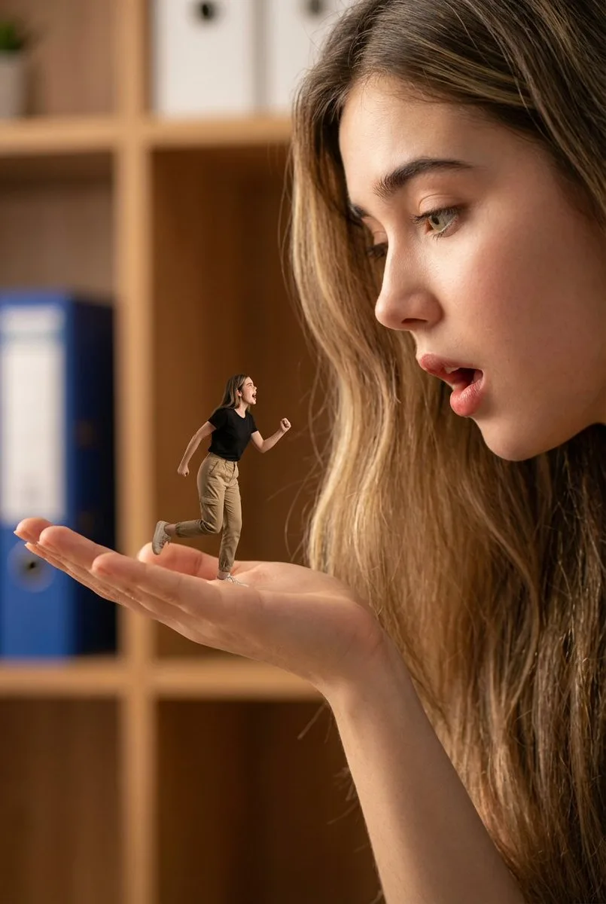

# Hania Ai — by @HaniaAi12

[← Back to Community Examples](../../EXAMPLES.md) · Category: Photography · Model: `Nano Banana`

<a href="https://x.com/HaniaAi12/status/2028065588048810491"></a>

Source: **[@HaniaAi12 on X](https://x.com/HaniaAi12/status/2028065588048810491)** · Creator: [Hania Ai](https://x.com/HaniaAi12)

## Prompt

```text
A hyper-realistic, 8k, high-fidelity photograph captured with a wide-angle lens and shallow depth of field, creating a dramatic forced perspective. The composition features a colossal human face and hand on the right side, filling the frame, with the hand extended palm-up towards the left. The giant person, with a full beard and mustache, has their mouth slightly agape in an expression of surprise or speech, looking down towards their palm. On the palm of this giant hand stands a miniature person, appearing tiny in comparison, wearing a black short-sleeved t-shirt and light khaki pants, with dark curly hair. This miniature figure is captured mid-action, with arms slightly bent and legs in a dynamic, running or reacting pose, also with an open mouth as if shouting or speaking. The background is an extremely blurred, warm-toned indoor setting, suggesting an office or study with hints of wooden shelves and a blue binder, providing a soft bokeh effect. Cinematic lighting illuminates the scene with soft, warm light, highlighting the highly detailed texture of the skin, hair, and clothing, while maintaining a natural, diffused quality. The character's face for both the giant and the miniature person is: uploaded face as reference.
```

## Try it

Paste the prompt into **[vinano.ai](https://vinano.ai?utm_source=github&utm_medium=readme&utm_campaign=awesome-image-video-prompts-updating&utm_content=x-page-try)** to generate your own version.

> The image and prompt belong to @HaniaAi12 ([original post](https://x.com/HaniaAi12/status/2028065588048810491)) and are shown here with credit for reference. Creators can ask for changes or removal by opening an issue.
