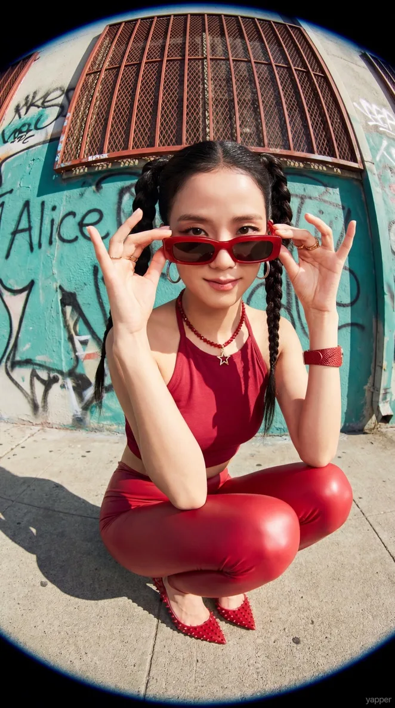

# Alice — by @youngcatwoman

[← Back to Community Examples](../../EXAMPLES.md) · Category: Photography · Model: `Nano Banana`

<a href="https://x.com/youngcatwoman/status/2032542713170838002"></a>

Source: **[@youngcatwoman on X](https://x.com/youngcatwoman/status/2032542713170838002)** · Creator: [Alice](https://x.com/youngcatwoman)

## Prompt

```text
Generate a highly detailed, photorealistic 8K streetwear fashion portrait of Rosé of Blackpink, who is dominating about 90% of the frame. The shot is taken from a low angle with a close-up perspective, using a wide-angle lens with heavy fisheye distortion to simulate a photo taken on a modern smartphone. She has her signature bleached blonde hair in thick pigtail braids, pale porcelain skin, and a confident expression. She is in a low, crouched squat position on the floor, balancing on the spiked high heels and both hands are placed flat on her thighs, leaning slightly forward, and looking directly at the camera. Cobalt-framed rectangular retro sunglasses slightly away from her eyes with both hands. She is wearing a cobalt blue cotton halter crop top, tight cobalt blue latex leggings, and cobalt blue high heels. Her accessories include a ruby bead necklace with a gold star pendant, silver hoop earrings, gold rings, and a cobalt blue bracelet with a raised texture. The outdoor setting features a vibrant, textured teal wall behind her with a graffiti written 'Alice' and a red metal grate above. The scene is lit by intense, direct daytime sunlight, creating hard shadows and high contrast. A small "yapper" watermark is in the bottom right corner. Aspect ratio 9:16.
```

## Try it

Paste the prompt into **[vinano.ai](https://vinano.ai?utm_source=github&utm_medium=readme&utm_campaign=awesome-image-video-prompts-updating&utm_content=x-page-try)** to generate your own version.

> The image and prompt belong to @youngcatwoman ([original post](https://x.com/youngcatwoman/status/2032542713170838002)) and are shown here with credit for reference. Creators can ask for changes or removal by opening an issue.
