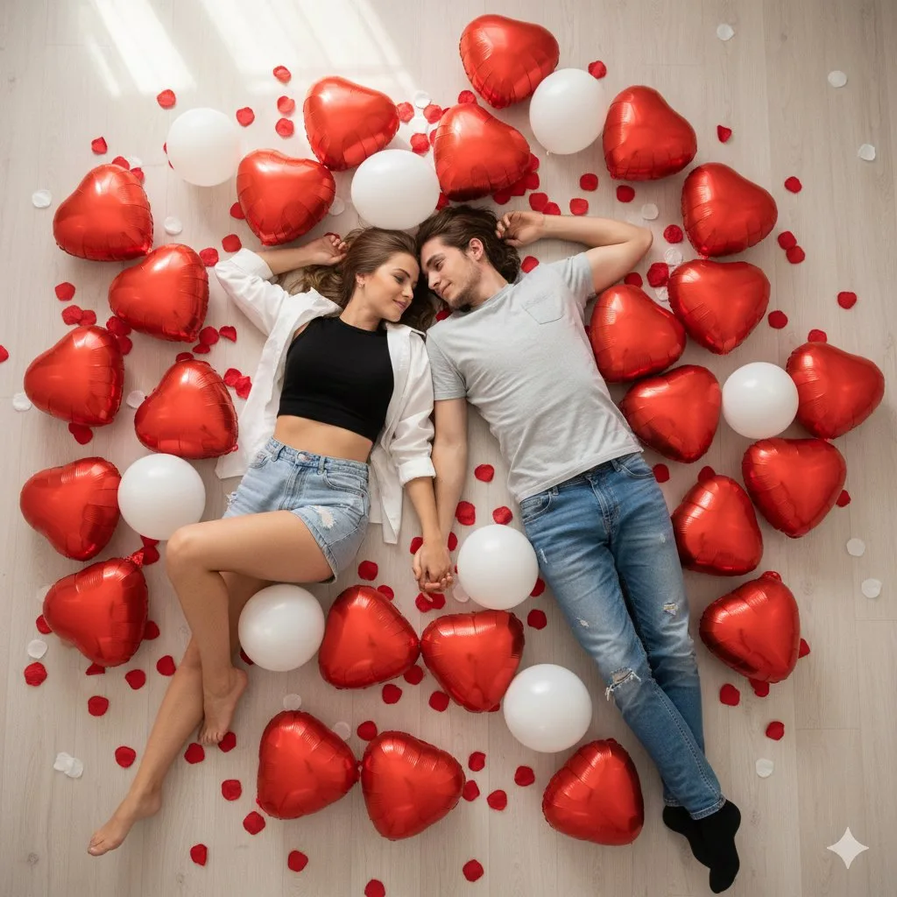

# 𓆩𝐀𝐛𝐢𝐝 𝐇𝐮𝐬𝐬𝐚𝐢𝐧𓆪 — by @AbidkingB

[← Back to Community Examples](../../EXAMPLES.md) · Category: Photography · Model: `Nano Banana`

<a href="https://x.com/AbidkingB/status/2022667985039823362"></a>

Source: **[@AbidkingB on X](https://x.com/AbidkingB/status/2022667985039823362)** · Creator: [𓆩𝐀𝐛𝐢𝐝 𝐇𝐮𝐬𝐬𝐚𝐢𝐧𓆪](https://x.com/AbidkingB)

## Prompt

```text
A hyper-realistic 8k high-angle overhead shot, captured with a wide-angle lens, presents a romantic scene of a couple lying on a light-colored wooden floor. The lighting is soft and natural, possibly from a window, creating gentle highlights on the balloons and subtle shadows on the floor, contributing to a cinematic atmosphere. The female subject, uploaded face as reference, is positioned on her back, wearing a black crop top, light blue denim shorts, and a white unbuttoned shirt draped over her. Her left arm is bent with her hand near her head, and her right arm is gently extended towards the male. The male subject, uploaded face as reference, is also on his back, wearing a light grey t-shirt and light blue distressed denim jeans. His left arm is bent, hand near the female's head, and his right arm is relaxed. They are lying close together, heads touching, looking into each other's eyes with soft, affectionate smiles. The entire floor around and between them is densely decorated with a multitude of shiny red heart-shaped foil balloons of varying sizes, interspersed with several white round latex balloons, and countless small red and white rose petals, creating a highly detailed texture and vibrant color contrast against the light wood. The composition is a full-body shot, showcasing the couple and the extensive, immersive decorations.
```

## Try it

Paste the prompt into **[vinano.ai](https://vinano.ai?utm_source=github&utm_medium=readme&utm_campaign=awesome-image-video-prompts-updating&utm_content=x-page-try)** to generate your own version.

> The image and prompt belong to @AbidkingB ([original post](https://x.com/AbidkingB/status/2022667985039823362)) and are shown here with credit for reference. Creators can ask for changes or removal by opening an issue.
