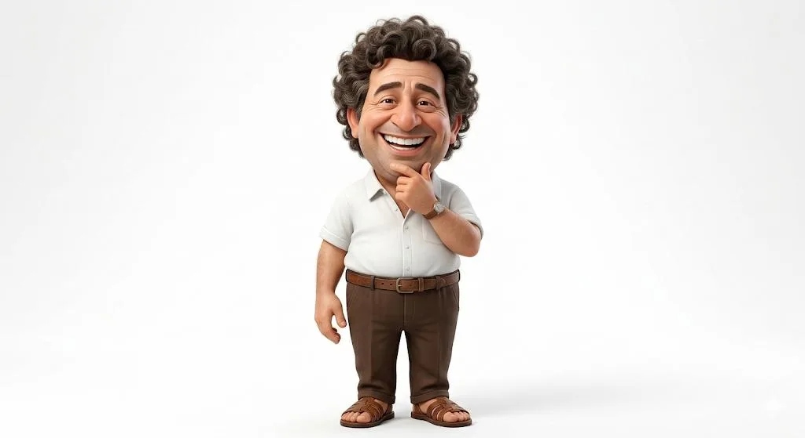

# auqib — by @auqibhabib

[← Back to Examples from X](../../EXAMPLES.md) · Category: Illustration & 3D · Model: `Nano Banana`

<a href="https://x.com/auqibhabib/status/2029363366192660526"></a>

Original post: **[@auqibhabib on X](https://x.com/auqibhabib/status/2029363366192660526)** · Creator: [auqib](https://x.com/auqibhabib)

## Prompt

```text
A highly detailed 3D caricature of a cheerful man with an oversized head, a big smile showcasing large teeth, and curly voluminous hair. He is wearing a short-sleeved white button-up shirt, brown high-waisted pants with a belt, and traditional sandals. His pose is casual and friendly, with one hand touching his chin in a thoughtful manner. The art style is semi-realistic with exaggerated cartoonish features, set aw against a clean white background.""A highly detailed 3D caricature of a cheerful man with an oversized head, a big smile showcasing large teeth, and curly voluminous hair. He is wearing a short-sleeved white button-up shirt, brown high-waisted pants with a belt, and traditional sandals. His pose is casual and friendly, with one hand touching his chin in a thoughtful manner. The art style is semi-realistic with exaggerated cartoonish features, set against a clean white background.
```

## Try it

Paste the prompt into **[vinano.ai](https://vinano.ai?utm_source=github&utm_medium=readme&utm_campaign=awesome-image-video-prompts-updating&utm_content=x-page-try)** to generate your own version.

> The image and prompt belong to [@auqibhabib](https://x.com/auqibhabib) and are shown here with credit for reference. Creators can ask for changes or removal by opening an issue.
