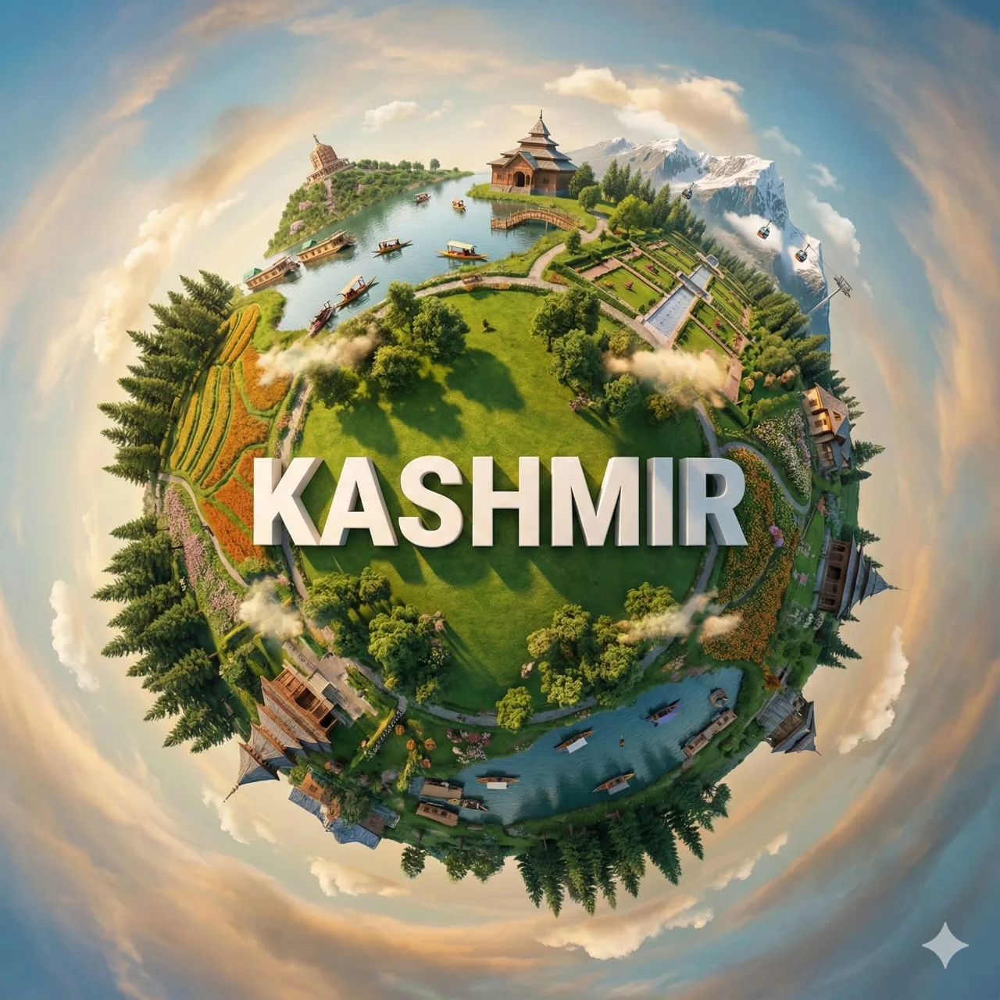

# Milo — by @Milo_Bahi_02

[← Back to Community Examples](../../EXAMPLES.md) · Category: Illustration & 3D · Model: `Nano Banana`

<a href="https://x.com/Milo_Bahi_02/status/2008699484260495802"></a>

Source: **[@Milo_Bahi_02 on X](https://x.com/Milo_Bahi_02/status/2008699484260495802)** · Creator: [Milo](https://x.com/Milo_Bahi_02)

## Prompt

```text
Create a hyper-realistic miniature planet showcasing [KASHMIR] with famous landmarks seamlessly curving around the spherical surface. Position bold 3D white text “[KASHMIR]” naturally integrated across the lush green central parkland with realistic shadows and dimensional depth. Capture from a top-down orbiting angle that emphasizes the dramatic planet curvature. Use soft golden hour daylight filtering through partly cloudy skies, casting gentle shadows on emerald grass and surrounding trees. The background should blend into a swirling atmospheric sky. Apply vibrant greens, warm earth tones, and soft blues. Render in polished photorealistic style with fine architectural detail. 1080x1080 format.
```

## Try it

Paste the prompt into **[vinano.ai](https://vinano.ai?utm_source=github&utm_medium=readme&utm_campaign=awesome-image-video-prompts-updating&utm_content=x-page-try)** to generate your own version.

> The image and prompt belong to @Milo_Bahi_02 ([original post](https://x.com/Milo_Bahi_02/status/2008699484260495802)) and are shown here with credit for reference. Creators can ask for changes or removal by opening an issue.
