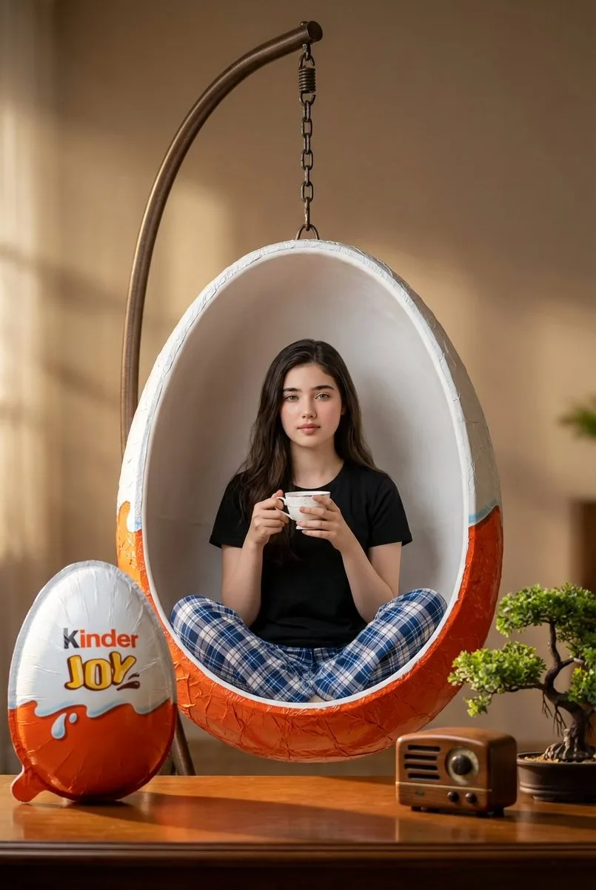

# Hania Ai — by @HaniaAi12

[← Back to Community Examples](../../EXAMPLES.md) · Category: Illustration & 3D · Model: `Nano Banana`

<a href="https://x.com/HaniaAi12/status/2028673990672216202"></a>

Source: **[@HaniaAi12 on X](https://x.com/HaniaAi12/status/2028673990672216202)** · Creator: [Hania Ai](https://x.com/HaniaAi12)

## Prompt

```text
A hyper-realistic, 8k, medium shot photograph captured with a standard lens and shallow depth of field, showcasing a surreal indoor scene with cinematic lighting. The composition features a normal-sized woman, using the uploaded face as reference, sitting cross-legged inside a colossal, highly detailed Kinder Joy egg that functions as a swing chair. The giant egg is split, with its white interior forming the seat and the orange, textured exterior visible, suspended by dark metal chains from a curved, dark metal stand.

The woman wears a black t-shirt and blue and white plaid pajama pants, holding a small white teacup with both hands, looking directly at the viewer with a calm and relaxed expression.

To the left in the foreground, on a highly detailed polished wooden table, stands another gigantic, fully wrapped Kinder Joy egg, exhibiting intricate foil texture and branding. To the right of the swing's base, also on the table, are miniature props: a vintage-style wooden radio with white dials and a tiny bonsai tree in a small pot.

The lighting is soft, warm, and directional from the left, casting subtle shadows and highlighting the highly detailed textures of the egg wrappers, the woman’s clothing, and the wooden surface. The background is a softly blurred, warm-toned interior wall, creating a pleasing bokeh effect.
```

## Try it

Paste the prompt into **[vinano.ai](https://vinano.ai?utm_source=github&utm_medium=readme&utm_campaign=awesome-image-video-prompts-updating&utm_content=x-page-try)** to generate your own version.

> The image and prompt belong to @HaniaAi12 ([original post](https://x.com/HaniaAi12/status/2028673990672216202)) and are shown here with credit for reference. Creators can ask for changes or removal by opening an issue.
