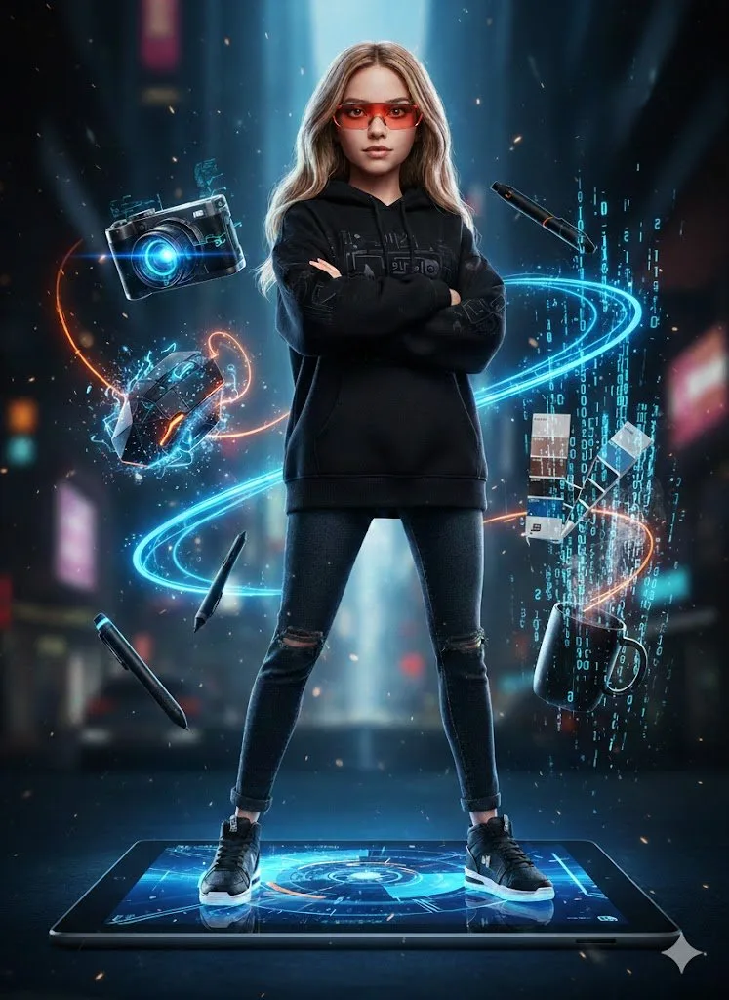

# Cherry 2.O — by @hey_m_cherry

[← Back to Examples from X](../../EXAMPLES.md) · Category: Illustration & 3D · Model: `Nano Banana`

<a href="https://x.com/hey_m_cherry/status/2011268158855000473"></a>

Original post: **[@hey_m_cherry on X](https://x.com/hey_m_cherry/status/2011268158855000473)** · Creator: [Cherry 2.O](https://x.com/hey_m_cherry)

## Prompt

```text
Hyper-realistic full-body portrait of a woman, using the exact pose from the uploaded photo, transformed into a stylish female doll. she stands confidently with arms crossed on a giant Microsoft Surface Tablet as a platform, wearing urban streetwear (black hoodie, jeans, sneakers) and sleek red tech glasses.

Surrounding him in a dynamic, floating arrangement are masculine graphic design tools: a futuristic camera with blue holographic glow, a geometric computer mouse with electric sparks, a digital pen creating digital wireframe trails, a floating Pantone swatch book in bold blue and black colors, and a minimalist black coffee mug with binary code steam.

The scene features a vibrant blue and orange color scheme with dynamic lighting. Cyberpunk aesthetic, neon accents, particle effects. Style is a blend of 3D animation and tech photography. Sharp focus, cinematic lighting, 8k resolution.
```

## Try it

Paste the prompt into **[vinano.ai](https://vinano.ai?utm_source=github&utm_medium=readme&utm_campaign=awesome-image-video-prompts-updating&utm_content=x-page-try)** to generate your own version.

> The image and prompt belong to [@hey_m_cherry](https://x.com/hey_m_cherry) and are shown here with credit for reference. Creators can ask for changes or removal by opening an issue.
