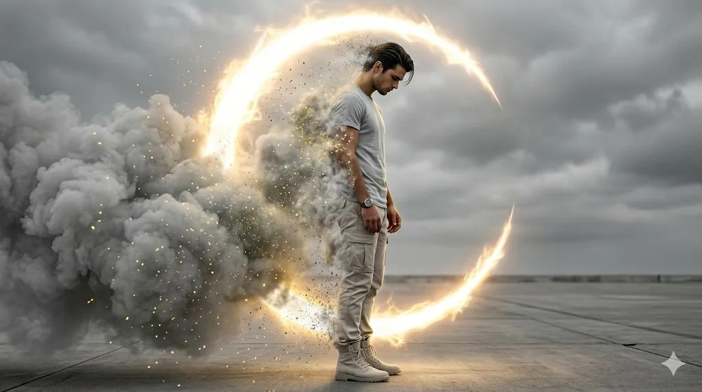

# auqib — by @auqibhabib

[← Back to Examples from X](../../EXAMPLES.md) · Category: Photography · Model: `Nano Banana`

<a href="https://x.com/auqibhabib/status/2028276251262423347"></a>

Original post: **[@auqibhabib on X](https://x.com/auqibhabib/status/2028276251262423347)** · Creator: [auqib](https://x.com/auqibhabib)

## Prompt

```text
Create an ultra-realistic, cinematic 8K image with high-contrast dramatic lighting and a photo-real digital painting aesthetic-use face reference exactly. The man is shown in a full-body side profile facing right, his face and hairstyle copied perfectly with no alterations He wears modern casual streetwear; a light grey crewneck t-shirt, light neutral cargo pants, light-colored high-top boots, and a watch on his left wrist. His posture is slightly slumped, head bowed, eyes looking downward, hands relaxed at his sides, conveying deep introspection and sorrow. Nearly half of his body is dissolving into extremely thick, cloud-like grey smoke filled with glowing yellow dust particles. His left arm, shoulder, torso, legs, and part of his hair become transparent as they break into luminous particles, suggesting active disintegration Behind and partially surrounding him is a massive glowing crescent (C-shaped) energy aura, emitting fiery golden-white plasma light. This aura acts as a powerful rim and backlight, highlighting the smoke, dust, and silhouette. The setting is minimal and stark: a concrete or desolate paved surface meeting a heavily overcast sky. The color palette is nearly monochrome greys and whites, contrasted by intense amber-gold glow, Shallow depth of field, glow/bloom lighting, particle dispersion, cinematic composition, emotional and dramatic atmosphere.
```

## Try it

Paste the prompt into **[vinano.ai](https://vinano.ai?utm_source=github&utm_medium=readme&utm_campaign=awesome-image-video-prompts-updating&utm_content=x-page-try)** to generate your own version.

> The image and prompt belong to [@auqibhabib](https://x.com/auqibhabib) and are shown here with credit for reference. Creators can ask for changes or removal by opening an issue.
