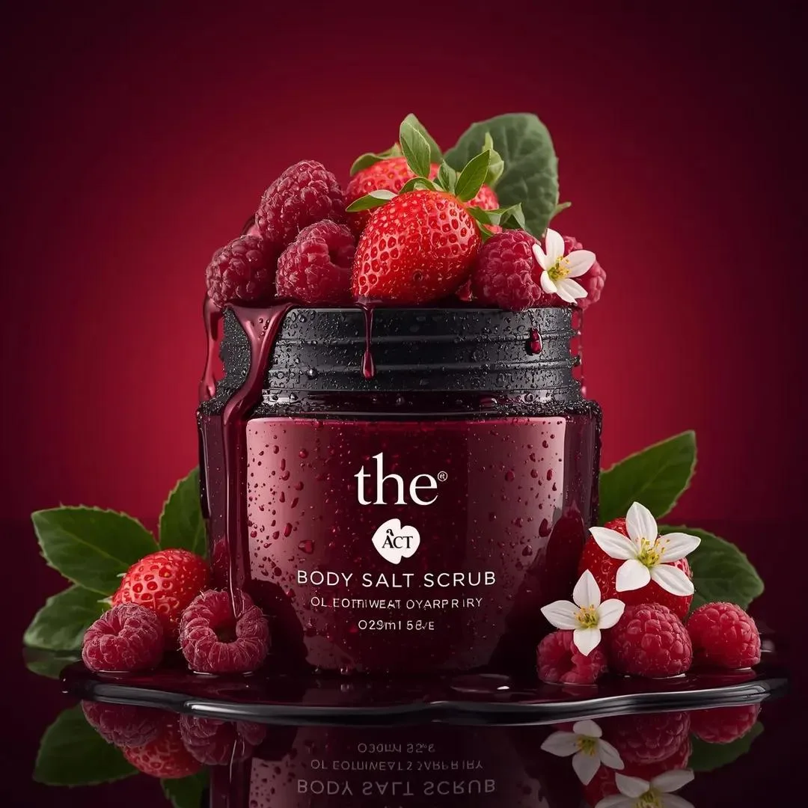

# Oogie — by @oggii_0

[← Back to Community Examples](../../EXAMPLES.md) · Category: Product & Brand · Model: `Nano Banana`

<a href="https://x.com/oggii_0/status/2029237707386568814"></a>

Source: **[@oggii_0 on X](https://x.com/oggii_0/status/2029237707386568814)** · Creator: [Oogie](https://x.com/oggii_0)

## Prompt

```text
Ultra-realistic luxury cosmetic product photography of a deep red glass jar labeled “the ACT Body Salt Scrub”, placed on a glossy reflective black surface. The jar is open and overflowing with fresh strawberries and raspberries, with berry juice dripping over the rim. Water droplets cover the jar creating a fresh, dewy look. Around the jar are scattered raspberries, strawberries, green leaves, and small white flowers. Background is a smooth gradient rich crimson red studio backdrop. Dramatic studio lighting, soft highlights, sharp macro detail, commercial beauty product advertisement style, high contrast, extremely detailed textures, 8k resolution, shallow depth of field, photorealistic, luxury skincare branding, centered composition.
```

## Try it

Paste the prompt into **[vinano.ai](https://vinano.ai?utm_source=github&utm_medium=readme&utm_campaign=awesome-image-video-prompts-updating&utm_content=x-page-try)** to generate your own version.

> The image and prompt belong to @oggii_0 ([original post](https://x.com/oggii_0/status/2029237707386568814)) and are shown here with credit for reference. Creators can ask for changes or removal by opening an issue.
