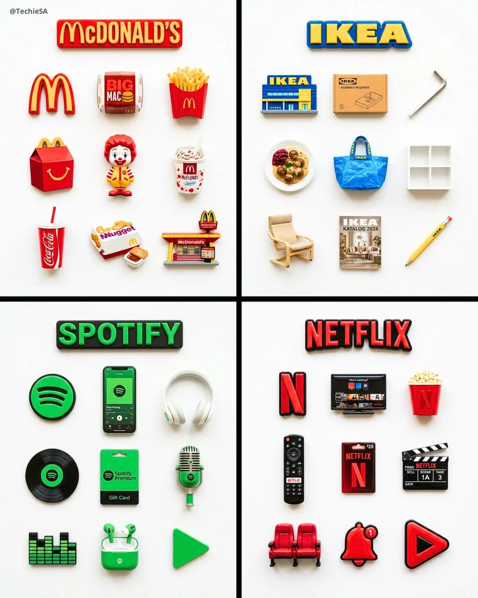

# TechieSA — by @TechieBySA

[← Back to Community Examples](../../EXAMPLES.md) · Category: UI & Graphic · Model: `Nano Banana`

<a href="https://x.com/TechieBySA/status/2040498492347420883"></a>

Source: **[@TechieBySA on X](https://x.com/TechieBySA/status/2040498492347420883)** · Creator: [TechieSA](https://x.com/TechieBySA)

## Prompt

```text
A flat-lay collection of exactly 9 hyper-realistic 3D resin fridge magnets arranged on a bright pure white surface in a clean 3x3 grid, themed around [BRAND]. At the very top center, a wide rectangular text magnet spells "BRAND" in bold 3D block letters in the brand's signature colors. Below it, 9 magnets in a clean 3x3 grid: the official logo badge, the most iconic hero product, a secondary iconic product, a third iconic product or packaging, a brand mascot or character chibi, a fifth iconic item, a sixth iconic item, a seventh iconic item, and the brand's storefront or headquarters building facade. Each magnet is small, neatly spaced with generous white space between them, slightly raised with a soft drop shadow beneath. Bright white background, warm studio lighting from above, photorealistic product render, top-down flat-lay angle, 4:5 aspect ratio
```

## Try it

Paste the prompt into **[vinano.ai](https://vinano.ai?utm_source=github&utm_medium=readme&utm_campaign=awesome-image-video-prompts-updating&utm_content=x-page-try)** to generate your own version.

> The image and prompt belong to @TechieBySA ([original post](https://x.com/TechieBySA/status/2040498492347420883)) and are shown here with credit for reference. Creators can ask for changes or removal by opening an issue.
