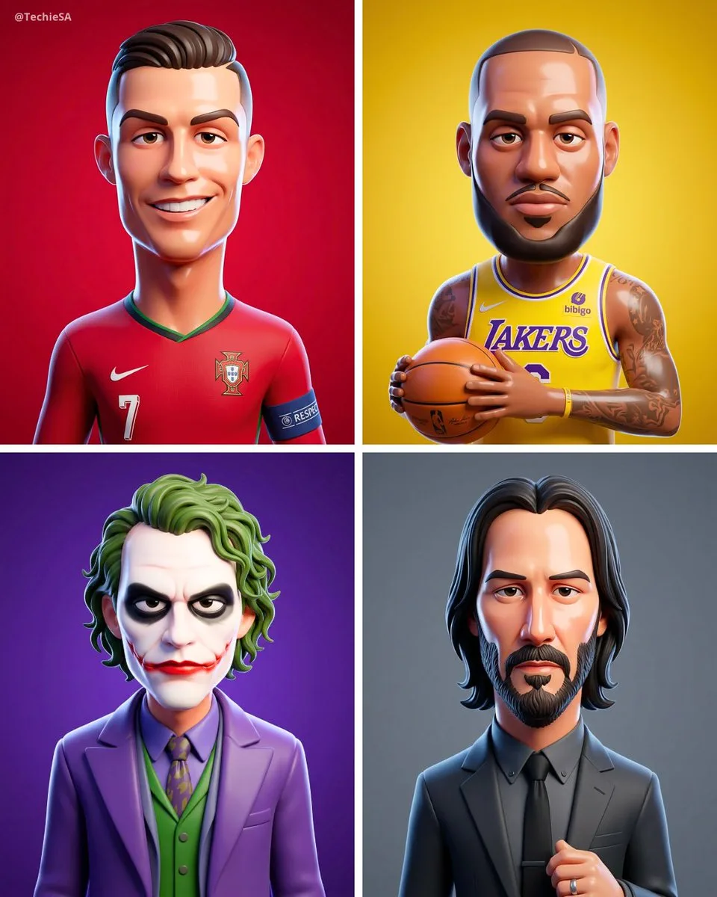

# TechieSA — by @TechieBySA

[← Back to Community Examples](../../EXAMPLES.md) · Category: Illustration & 3D · Model: `Nano Banana`

<a href="https://x.com/TechieBySA/status/2043020207447310430"></a>

Source: **[@TechieBySA on X](https://x.com/TechieBySA/status/2043020207447310430)** · Creator: [TechieSA](https://x.com/TechieBySA)

## Prompt

```text
Transform the person from the attached photo into a smooth stylized 3D cartoon character in the same style as the reference. Keep all real facial features fully recognizable but translated into exaggerated proportions (elongated head, big eyelids, soft rounded shapes). Skin should look glossy and plastic-like with clean gradients and subtle highlights. Use soft studio lighting, a solid [COLOR] color background, and high-end Pixar- inspired rendering. Simplify details, add gentle rim light, and preserve the person's hairstyle and accessories in stylized form. The final look must match the clean polished 3D aesthetic of the reference,  4:5 dimension.
```

## Try it

Paste the prompt into **[vinano.ai](https://vinano.ai?utm_source=github&utm_medium=readme&utm_campaign=awesome-image-video-prompts-updating&utm_content=x-page-try)** to generate your own version.

> The image and prompt belong to @TechieBySA ([original post](https://x.com/TechieBySA/status/2043020207447310430)) and are shown here with credit for reference. Creators can ask for changes or removal by opening an issue.
