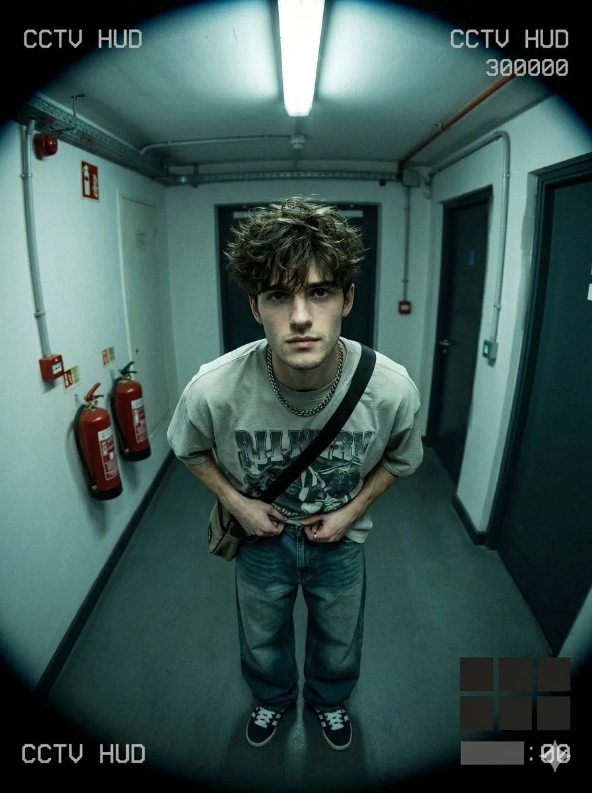

# Harboris — by @harboriis

[← Back to Community Examples](../../EXAMPLES.md) · Category: Photography · Model: `Nano Banana`

<a href="https://x.com/harboriis/status/2041359077423419632"></a>

Source: **[@harboriis on X](https://x.com/harboriis/status/2041359077423419632)** · Creator: [Harboris](https://x.com/harboriis)

## Prompt

```text
Use uploaded selfie as ONLY face reference; preserve exact likeness/age/hair and natural skin texture; no beautification, no face mixing. Ultra-realistic CCTV/security camera still frame in a building hallway: ceiling corner mount view (high angle 60-70° top-down), wide 2.8-3.6mm fisheye barrel distortion, edge warping. Subject centered under the camera, looking up directly into lens with a cool unbothered expression, one hand adjusting the waistband, the other holding a bag strap or hanging relaxed. Outfit (strict, unisex): oversized graphic print T-shirt (generic print, no readable text/logos), wide baggy jeans, Adidas Campus sneakers (recognizable silhouette), chunky chain necklace. CCTV look: low-light greenish/blue tint, interlaced scanlines, H.264 block compression, mild noise, slight motion smear on background only, timestamp/HUD present but blurred/unreadable (no readable text), vignetting, ceiling light glare. Face is the sharpest point. 3:4
```

## Try it

Paste the prompt into **[vinano.ai](https://vinano.ai?utm_source=github&utm_medium=readme&utm_campaign=awesome-image-video-prompts-updating&utm_content=x-page-try)** to generate your own version.

> The image and prompt belong to @harboriis ([original post](https://x.com/harboriis/status/2041359077423419632)) and are shown here with credit for reference. Creators can ask for changes or removal by opening an issue.
