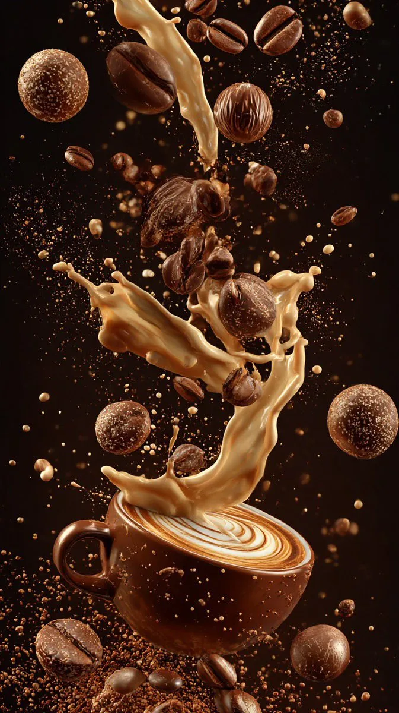

# Duet | AI — by @Sheldon056

[← Back to Community Examples](../../EXAMPLES.md) · Category: Food & Drink · Model: `Nano Banana`

<a href="https://x.com/Sheldon056/status/2018525091420934651"></a>

Source: **[@Sheldon056 on X](https://x.com/Sheldon056/status/2018525091420934651)** · Creator: [Duet | AI](https://x.com/Sheldon056)

## Prompt

```text
Ultra-cinematic vertical composition of coffee elements suspended in mid-air cascading roasted coffee beans, chocolate bonbons, swirling latte art in a mid-air coffee cup, splashes of milk and espresso frozen in motion, fine coffee grounds dusting through the air captured with rich brown and cream color tones.
Hyper-detailed textures with glossy liquid surfaces, crema bubbles, and matte bean textures, lit with dramatic high-contrast studio lighting against a deep, velvety black background. Cinematic depth of field, splash photography aesthetic, premium café advertising style. Shot with a virtual Nikon D850, 105mm macro lens, aperture f/4.0, crisp editorial clarity.
```

## Try it

Paste the prompt into **[vinano.ai](https://vinano.ai?utm_source=github&utm_medium=readme&utm_campaign=awesome-image-video-prompts-updating&utm_content=x-page-try)** to generate your own version.

> The image and prompt belong to @Sheldon056 ([original post](https://x.com/Sheldon056/status/2018525091420934651)) and are shown here with credit for reference. Creators can ask for changes or removal by opening an issue.
