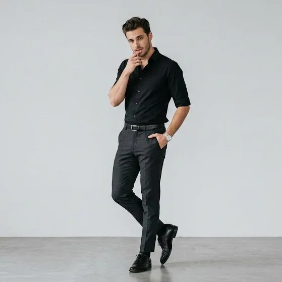

# Cherry 2.O — by @Mind_Boticni

[← Back to Community Examples](../../EXAMPLES.md) · Category: Photography · Model: `Nano Banana`

<a href="https://x.com/Mind_Boticni/status/2041021416775323737"></a>

Source: **[@Mind_Boticni on X](https://x.com/Mind_Boticni/status/2041021416775323737)** · Creator: [Cherry 2.O](https://x.com/Mind_Boticni)

## Prompt

```text
Full-body portrait of a stylish young man standing against a plain light gray background, wearing a fitted black button-up shirt with sleeves rolled up, dark gray slim-fit trousers, and black polished dress shoes. He is posing casually with one hand in his pocket and the other hand near his mouth, slightly lifting one leg. The lighting is soft and even, highlighting his natural features, with a clean minimalist studio aesthetic. Realistic proportions, high-detail, sharp focus, fashion photography style.
```

## Try it

Paste the prompt into **[vinano.ai](https://vinano.ai?utm_source=github&utm_medium=readme&utm_campaign=awesome-image-video-prompts-updating&utm_content=x-page-try)** to generate your own version.

> The image and prompt belong to @Mind_Boticni ([original post](https://x.com/Mind_Boticni/status/2041021416775323737)) and are shown here with credit for reference. Creators can ask for changes or removal by opening an issue.
