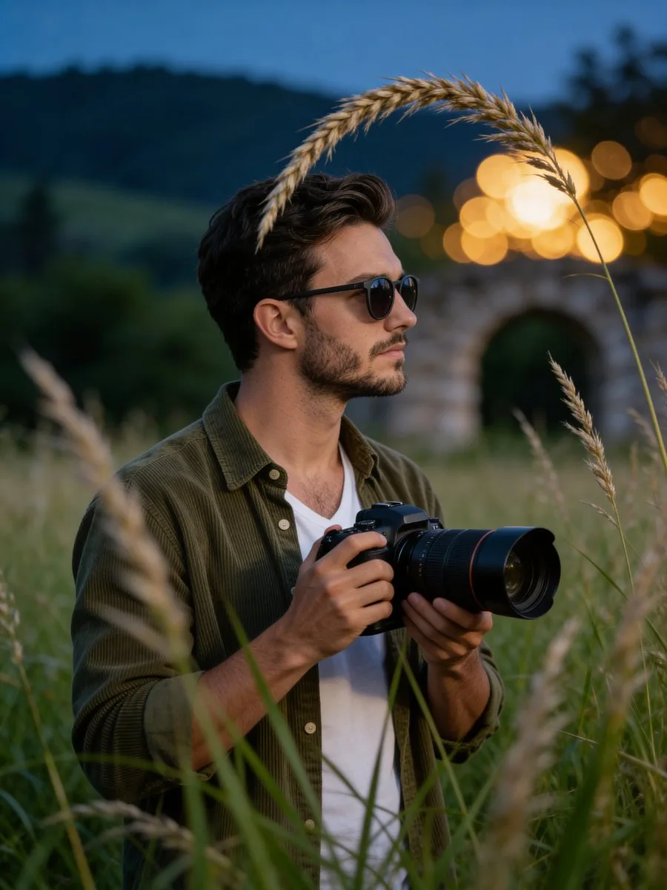

# K — by @ChillaiKalan__

[← Back to Examples from X](../../EXAMPLES.md) · Category: Photography · Model: `Nano Banana`

<a href="https://x.com/ChillaiKalan__/status/2043664090384801799"></a>

Original post: **[@ChillaiKalan__ on X](https://x.com/ChillaiKalan__/status/2043664090384801799)** · Creator: [K](https://x.com/ChillaiKalan__)

## Prompt

```text
Cinematic medium shot of a young man with a trimmed beard and short brown hair, standing upright in a lush meadow at
twilight. He is captured in profile, looking toward the right, holding a professional black mirrorless camera with a long
telephoto lens to his eye level. He wears an olive green corduroy button-down shirt over a plain white t-shirt. The man's chest below the area is hidden inside the grass. The foreground features
tall, sharp blades of grass and soft, out-of-focus wheat stalks creating a natural frame. The foreground is filled with tall, deeply blurred wispy wild grasses, with one very prominent blade
starting near the camera and arcing high above and across his head, creating a strong layer of depth. The background is a
masterclass in bokeh: deep moody blues and greens of distant rolling hills and trees, with a soft motion blur effect on the foliage Large, warm golden bokeh light orbs glow softly in the distance
near a blurred stone archway. High-end photography, 85mm lens, f/1.8, moody atmosphere, sharp focus on the subject with a creamy, cinematic background. ar 4:5
```

## Try it

Paste the prompt into **[vinano.ai](https://vinano.ai?utm_source=github&utm_medium=readme&utm_campaign=awesome-image-video-prompts-updating&utm_content=x-page-try)** to generate your own version.

> The image and prompt belong to [@ChillaiKalan__](https://x.com/ChillaiKalan__) and are shown here with credit for reference. Creators can ask for changes or removal by opening an issue.
