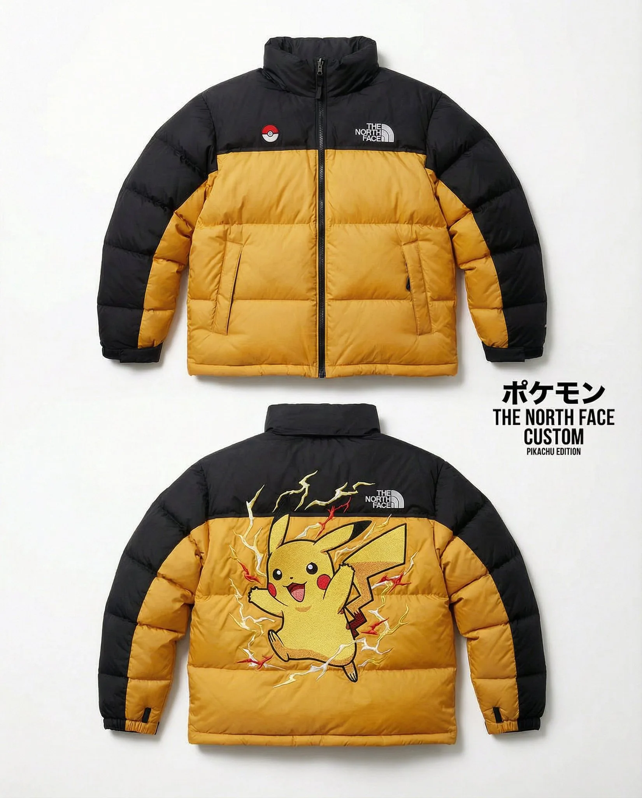

# INK — by @0xInk_

[← Back to Examples from X](../../EXAMPLES.md) · Category: Product & Brand · Model: `Nano Banana`

<a href="https://x.com/0xInk_/status/2009203433325432953"></a>

Original post: **[@0xInk_ on X](https://x.com/0xInk_/status/2009203433325432953)** · Creator: [INK](https://x.com/0xInk_)

## Prompt

```text
High-end editorial product shot of a custom The North Face Nuptse 700 puffer jacket inspired by [POKEMON].
The jacket’s primary colorway automatically derives from [POKEMON]’s dominant palette (main body color as base tone, secondary accents used sparingly for contrast), translated into premium, wearable hues — never cartoonish, always fashion-forward.
A large-scale embroidered [POKEMON] artwork dominates the back panel, adapted to the jacket’s quilted structure.
Embroidery style reflects [POKEMON]’s core identity:

aggressive Pokémon → bold stitch density, sharp contours
elegant or mystical Pokémon → flowing lines, layered thread gradients

armored or mechanical Pokémon → heavy, structured embroidery with tactile depth

The front of the jacket remains minimal and restrained:
clean TNF logo, subtle Poké Ball patch, no additional graphics.

Material realism is critical: visible fabric sheen, natural puff volume, precise seam alignment, embroidery threads sitting slightly raised from the nylon surface.

Shot in a Japanese fashion magazine product layout, pure white background.
Front and back views presented together, jacket floating upright, perfectly centered.
Lighting is clean, studio-soft with controlled contrast to emphasize texture and craftsmanship.

Mood: luxury streetwear meets collectible archive piece.
No model. No props. No distractions.
Ultra-sharp focus, high resolution, editorial polish, timeless design.
```

## Try it

Paste the prompt into **[vinano.ai](https://vinano.ai?utm_source=github&utm_medium=readme&utm_campaign=awesome-image-video-prompts-updating&utm_content=x-page-try)** to generate your own version.

> The image and prompt belong to [@0xInk_](https://x.com/0xInk_) and are shown here with credit for reference. Creators can ask for changes or removal by opening an issue.
