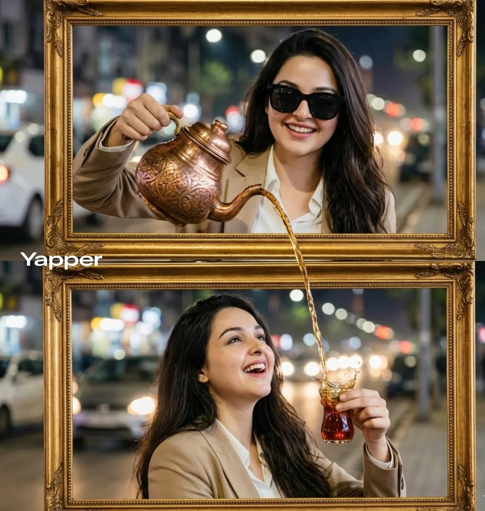

# Synthia — by @AIwithSynthia

[← Back to Community Examples](../../EXAMPLES.md) · Category: Photography · Model: `Nano Banana`

<a href="https://x.com/AIwithSynthia/status/2030799128343798247"></a>

Source: **[@AIwithSynthia on X](https://x.com/AIwithSynthia/status/2030799128343798247)** · Creator: [Synthia](https://x.com/AIwithSynthia)

## Prompt

```text
Ultra-realistic cinematic two-frame composition. In the top golden vintage frame, an elegant stylish woman wearing a beige blazer, white shirt, and black sunglasses smiles while pouring tea from an ornate engraved copper teapot outward from the frame. The tea flows smoothly out of the frame into the lower frame. In the bottom golden frame, the same woman tilts her head back slightly with a joyful expression, holding a traditional Turkish tea glass as the tea splashes dramatically into it mid-air. Nighttime city skyline with warm glowing lights and water reflections in the background, shallow depth of field, dramatic lighting, high detail, surreal perspective illusion where the liquid connects both frames, cinematic photography, ultra realistic, 8k.
```

## Try it

Paste the prompt into **[vinano.ai](https://vinano.ai?utm_source=github&utm_medium=readme&utm_campaign=awesome-image-video-prompts-updating&utm_content=x-page-try)** to generate your own version.

> The image and prompt belong to @AIwithSynthia ([original post](https://x.com/AIwithSynthia/status/2030799128343798247)) and are shown here with credit for reference. Creators can ask for changes or removal by opening an issue.
