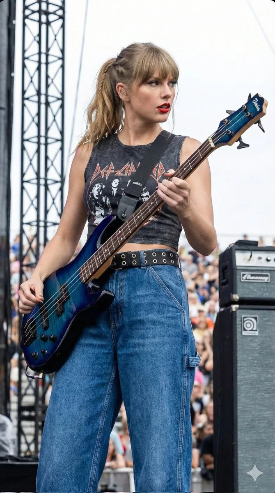

# TJ — by @TAB_TAB_HH

[← Back to Community Examples](../../EXAMPLES.md) · Category: Photography · Model: `Nano Banana`

<a href="https://x.com/TAB_TAB_HH/status/2016049616807198778"></a>

Source: **[@TAB_TAB_HH on X](https://x.com/TAB_TAB_HH/status/2016049616807198778)** · Creator: [TJ](https://x.com/TAB_TAB_HH)

## Prompt

```text
{
  "image_generation_prompt": {
    "subject": {
      "main": "young female musician bass guitarist performing live on an outdoor stage",
      "appearance": "long dark wavy layered hair blowing slightly in wind, fair skin, intense focused facial expression, natural makeup, silver hoop earrings",
      "pose": "standing confidently holding a bass guitar, fingers plucking strings, looking slightly off-camera to the left"
    },
    "attire": {
      "top": "sleeveless dark grey acid-wash graphic crop top with vintage band aesthetic",
      "bottoms": "loose fit wide-leg blue denim carpenter jeans with large pockets",
      "accessories": "black leather belt with double row silver grommets, wide black guitar strap"
    },
    "instrument": {
      "type": "modern electric bass guitar",
      "details": "deep blue burst finish with visible wood grain texture (quilted maple top), black hardware, long guitar neck, intricate fretboard details"
    },
    "environment": {
      "setting": "daytime outdoor concert stage, open air festival vibe",
      "background_elements": "blurred stage truss structures, black bass amplifier stack with metal grille, microphone stand on the left, overcast bright sky"
    },
    "technical_style": {
      "quality": "ultra realistic, 8k uhd, hdr, masterwork, sharp focus, high fidelity textures",
      "lighting": "natural diffuse daylight, soft shadows, cinematic lighting",
      "camera": "telephoto lens, depth of field, bokeh background, portrait photography"
    }
  },
  "parameters": {
    "aspect_ratio": "9:16",
    "orientation": "vertical long",
    "resolution": "highest possible"
  }
}
```

## Try it

Paste the prompt into **[vinano.ai](https://vinano.ai?utm_source=github&utm_medium=readme&utm_campaign=awesome-image-video-prompts-updating&utm_content=x-page-try)** to generate your own version.

> The image and prompt belong to @TAB_TAB_HH ([original post](https://x.com/TAB_TAB_HH/status/2016049616807198778)) and are shown here with credit for reference. Creators can ask for changes or removal by opening an issue.
