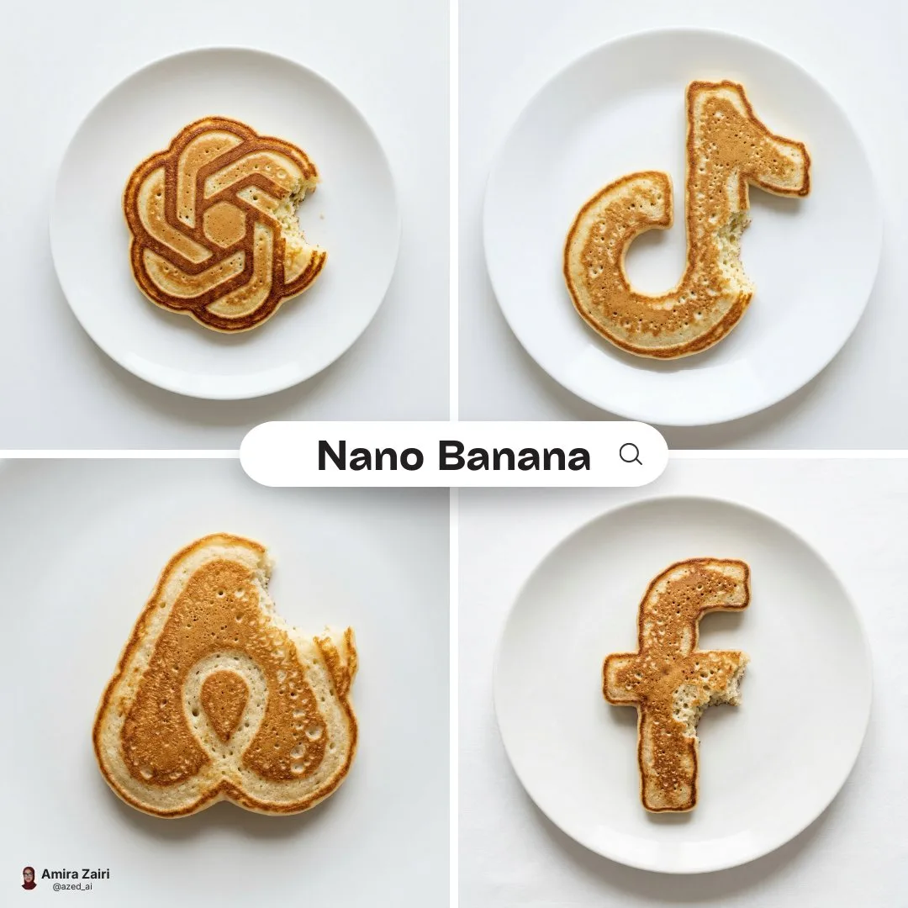

# Amira Zairi — by @azed_ai

[← Back to Examples from X](../../EXAMPLES.md) · Category: Illustration & 3D · Model: `Nano Banana`

<a href="https://x.com/azed_ai/status/2033181947103773158"></a>

Original post: **[@azed_ai on X](https://x.com/azed_ai/status/2033181947103773158)** · Creator: [Amira Zairi](https://x.com/azed_ai)

## Prompt

```text
hyper-realistic food photography of a pancake shaped precisely like the [brand name] logo, natural golden-brown pancake texture, soft porous surface with realistic bubbles, slightly crispy edges, placed on a pure white background, minimal composition, soft natural shadow beneath, top-down flat lay perspective, subtle bite taken from one edge revealing fluffy interior, realistic crumb texture, soft diffused studio lighting, ultra detailed, clean commercial aesthetic, sharp focus
```

## Try it

Paste the prompt into **[vinano.ai](https://vinano.ai?utm_source=github&utm_medium=readme&utm_campaign=awesome-image-video-prompts-updating&utm_content=x-page-try)** to generate your own version.

> The image and prompt belong to [@azed_ai](https://x.com/azed_ai) and are shown here with credit for reference. Creators can ask for changes or removal by opening an issue.
