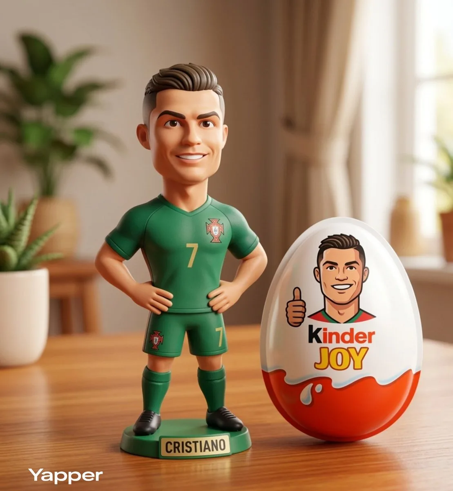

# Synthia — by @AIwithSynthia

[← Back to Examples from X](../../EXAMPLES.md) · Category: Illustration & 3D · Model: `Nano Banana`

<a href="https://x.com/AIwithSynthia/status/2032973567760232717"></a>

Original post: **[@AIwithSynthia on X](https://x.com/AIwithSynthia/status/2032973567760232717)** · Creator: [Synthia](https://x.com/AIwithSynthia)

## Prompt

```text
A cute stylized 3D collectible figurine inspired by Cristiano Ronaldo, with short styled hair and an athletic build, wearing a modern football kit and standing confidently with hands on hips. Next to him is a large Kinder Joy egg featuring a cartoon avatar of the same football star printed on the shell. The scene is placed on a wooden table with soft natural lighting, shallow depth of field, cozy indoor background with blurred plants, highly detailed Pixar-style 3D render, glossy toy texture, cinematic lighting, ultra-detailed product photography, designer toy aesthetic. ⚽🥚
```

## Try it

Paste the prompt into **[vinano.ai](https://vinano.ai?utm_source=github&utm_medium=readme&utm_campaign=awesome-image-video-prompts-updating&utm_content=x-page-try)** to generate your own version.

> The image and prompt belong to [@AIwithSynthia](https://x.com/AIwithSynthia) and are shown here with credit for reference. Creators can ask for changes or removal by opening an issue.
