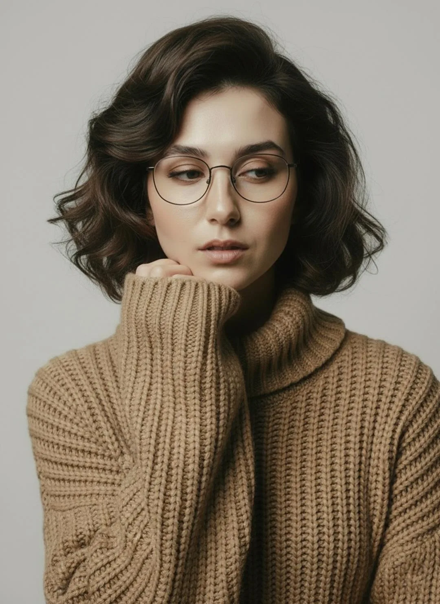

# Taaruk — by @Taaruk_

[← Back to Examples from X](../../EXAMPLES.md) · Category: Photography · Model: `Nano Banana`

<a href="https://x.com/Taaruk_/status/2009911679728206114"></a>

Original post: **[@Taaruk_ on X](https://x.com/Taaruk_/status/2009911679728206114)** · Creator: [Taaruk](https://x.com/Taaruk_)

## Prompt

```text
{
  "Objective": "Create a minimalist fashion studio portrait series with a calm, Scandinavian editorial mood",
  "PersonaDetails": {
    "Subject": {
      "Type": "Young woman",
      "Hair": "Short, softly waved dark-brown hair",
      "Accessories": "Thin round eyeglasses",
      "Expression": "Calm, introspective",
      "Skin": "Natural skin texture with minimal retouching"
    }
  },
  "Wardrobe": {
    "Top": "Chunky camel-colored knit turtleneck sweater",
    "Bottom": "Beige trousers",
    "Style": "Timeless autumn fashion"
  },
  "SceneDescription": {
    "Environment": "Minimalist studio",
    "Background": "Neutral off-white backdrop",
    "OverallFeel": "Clean, airy, understated"
  },
  "PortraitSeries": {
    "SeriesType": "Four-image set",
    "Poses": [
      {
        "Description": "Seated pose with hands gently clasped under the chin",
        "Mood": "Quiet, reflective"
      },
      {
        "Description": "Front-facing portrait with eyes lowered",
        "Mood": "Soft, contemplative"
      },
      {
        "Description": "Three-quarter side profile with arms crossed",
        "Mood": "Poised, thoughtful"
      },
      {
        "Description": "Close-up portrait with sweater sleeve raised near the face",
        "Mood": "Intimate, tactile"
      }
    ]
  },
  "Composition": {
    "Framing": "Varied framing from close-up to mid-length",
    "NegativeSpace": "Generous, balanced negative space",
    "DepthOfField": "Shallow depth of field for gentle separation"
  },
  "LightingAndColor": {
    "Lighting": "Soft, diffused studio lighting",
    "Highlights": "Subtle, natural highlights",
    "ColorPalette": "Muted warm neutrals (camel, beige, off-white)"
  },
  "ArtDirection": {
    "Style": "Scandinavian editorial photography",
    "Aesthetic": "Minimalist, timeless, understated luxury",
    "TextureEmphasis": "Knit fabric and natural skin detail"
  },
  "PhotographyStyle": {
    "Genre": "Professional fashion studio photography",
    "RealismLevel": "High realism with restrained processing",
    "Finish": "Clean, modern, magazine-ready"
  },
  "Mood": {
    "Tone": "Calm, introspective, serene",
    "SeasonalFeel": "Autumn warmth and quiet elegance"
  },
  "NegativePrompt": [
    "busy background",
    "harsh lighting",
    "bold colors",
    "heavy makeup",
    "over-retouching",
    "glossy fashion look",
    "street photography"
  ],
  "ResponseFormat": {
    "Type": "Portrait series",
    "ImageCount": 4,
    "Orientation": "Portrait",
    "AspectRatio": "2:3"
  }
}
```

## Try it

Paste the prompt into **[vinano.ai](https://vinano.ai?utm_source=github&utm_medium=readme&utm_campaign=awesome-image-video-prompts-updating&utm_content=x-page-try)** to generate your own version.

> The image and prompt belong to [@Taaruk_](https://x.com/Taaruk_) and are shown here with credit for reference. Creators can ask for changes or removal by opening an issue.
