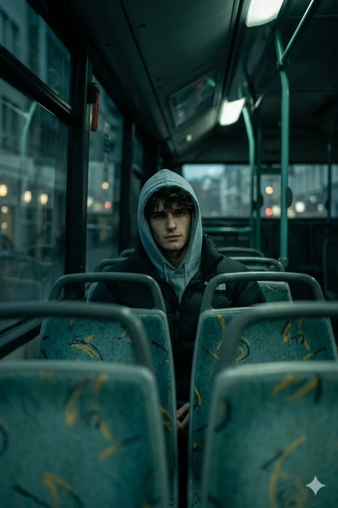

# Harboriis — by @harboriis

[← Back to Community Examples](../../EXAMPLES.md) · Category: Photography · Model: `Nano Banana`

<a href="https://x.com/harboriis/status/2030579799702614086"></a>

Source: **[@harboriis on X](https://x.com/harboriis/status/2030579799702614086)** · Creator: [Harboriis](https://x.com/harboriis)

## Prompt

```text
Create A deeply atmospheric and cinematic interior shot, captured from a slightly low-angle perspective, looks forward from an empty seat in a dimly lit bus. The primary subject is this man seated a few rows ahead, looking directly back at the camera with a subtle, intense gaze. He wears a dark, puffy winter jacket and has the hood of a light blue-grey hoodie pulled up over his head, partially obscuring his face and casting his eyes in shadow, adding a sense of mystery. The overall color grading is cool and desaturated, dominated by deep teal, dark blues, and muted greens, lending a melancholic or introspective mood. The interior of the bus is sparsely lit, with artificial lights casting soft, localized glows and deep shadows. The seats in the foreground, upholstered in a faded teal fabric with abstract yellow patterns, are in soft focus, guiding the eye towards the subject. Through the windows, blurred reflections of the city lights and exterior environment are visible, creating a sense of movement and urban isolation. The man's skin tone (take reference from the image) is rendered with natural texture, visible through the cool-toned lighting. The lighting emphasizes the contours of his face and the folds of his clothing, creating a sense of depth and realism within the muted palette. This shot would likely use a relatively slow shutter speed (e.g., 1/60th or 1/30th of a second) and a moderately wide aperture (e.g., f/2.8-f/4) to capture the low light and atmospheric blur.
```

## Try it

Paste the prompt into **[vinano.ai](https://vinano.ai?utm_source=github&utm_medium=readme&utm_campaign=awesome-image-video-prompts-updating&utm_content=x-page-try)** to generate your own version.

> The image and prompt belong to @harboriis ([original post](https://x.com/harboriis/status/2030579799702614086)) and are shown here with credit for reference. Creators can ask for changes or removal by opening an issue.
