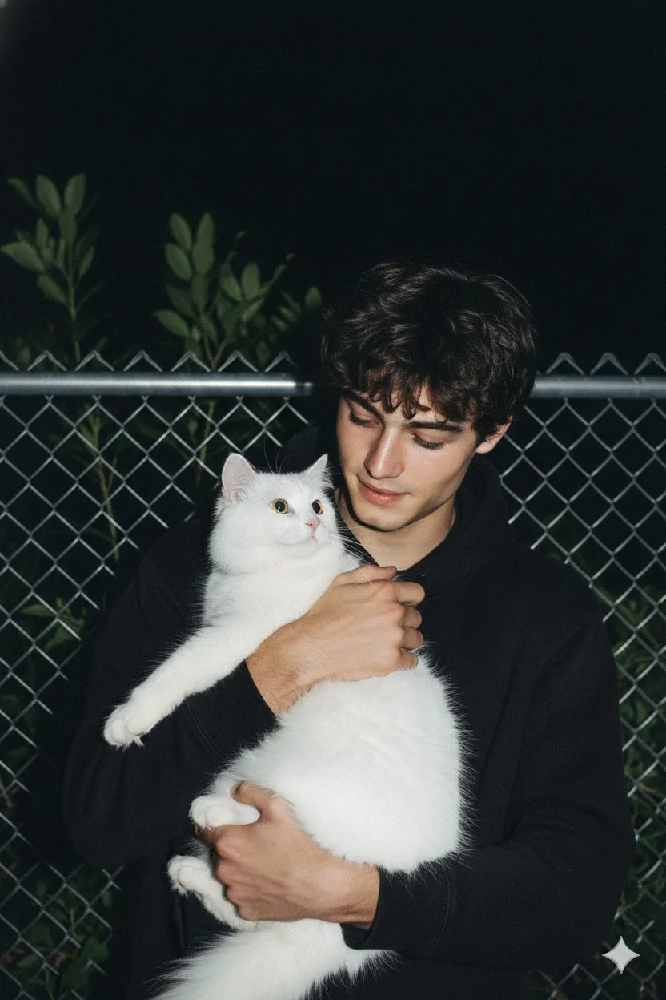

# Harboriis — by @harboriis

[← Back to Community Examples](../../EXAMPLES.md) · Category: Photography · Model: `Nano Banana`

<a href="https://x.com/harboriis/status/2009636791251530120"></a>

Source: **[@harboriis on X](https://x.com/harboriis/status/2009636791251530120)** · Creator: [Harboriis](https://x.com/harboriis)

## Prompt

```text
A raw, candid smartphone-style photo taken at night with a soft bright, direct camera flash, use my face on this image, featuring a man with middle-parted dark hair and a soft, gentle expression looking affectionately at a large, fluffy white cat that he is holding in his arms. The man is wearing a plain black hoodie, and the cat is looking back at him, creating a heartwarming moment. The background consists of a metal chain-link fence with some dark green leafy plants visible behind it, all set against a pitch-black night sky. The lighting has a nostalgic, slightly grainy 2010s digital camera aesthetic with high contrast, sharp shadows, and a natural, unpolished vibe.
```

## Try it

Paste the prompt into **[vinano.ai](https://vinano.ai?utm_source=github&utm_medium=readme&utm_campaign=awesome-image-video-prompts-updating&utm_content=x-page-try)** to generate your own version.

> The image and prompt belong to @harboriis ([original post](https://x.com/harboriis/status/2009636791251530120)) and are shown here with credit for reference. Creators can ask for changes or removal by opening an issue.
