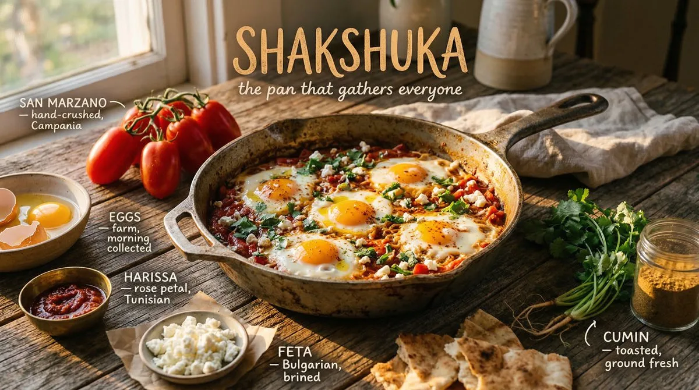

# Alexandra Aisling — by @AllaAisling

[← Back to Community Examples](../../EXAMPLES.md) · Category: Food & Drink · Model: `Nano Banana`

<a href="https://x.com/AllaAisling/status/2031758798432428099"></a>

Source: **[@AllaAisling on X](https://x.com/AllaAisling/status/2031758798432428099)** · Creator: [Alexandra Aisling](https://x.com/AllaAisling)

## Prompt

```text
[DISH] styled on a weathered [MATERIAL] surface, shot in pure golden hour light streaming from one side, casting long warm shadows. Hero dish center, surrounded by its raw ingredients casually scattered with artistic intention, whole vegetables, fresh herbs, open spice jars, linen cloth, wooden spoon. Every surface texture hyperreal: wood grain, condensation droplets, herb oil sheen, char marks. Ingredient labels as small handwritten-style chalk or ink tags resting beside each item: "[INGREDIENT] — [origin, preparation]". Dish name in warm hand-lettered typography: "[DISH NAME]". Subtitle: "[TAGLINE]". Mood: Ottolenghi cookbook meets Italian farmhouse meets Sunday farmers market. Warm golden tones, long shadows, film grain, extraordinary and craveable.
```

## Try it

Paste the prompt into **[vinano.ai](https://vinano.ai?utm_source=github&utm_medium=readme&utm_campaign=awesome-image-video-prompts-updating&utm_content=x-page-try)** to generate your own version.

> The image and prompt belong to @AllaAisling ([original post](https://x.com/AllaAisling/status/2031758798432428099)) and are shown here with credit for reference. Creators can ask for changes or removal by opening an issue.
