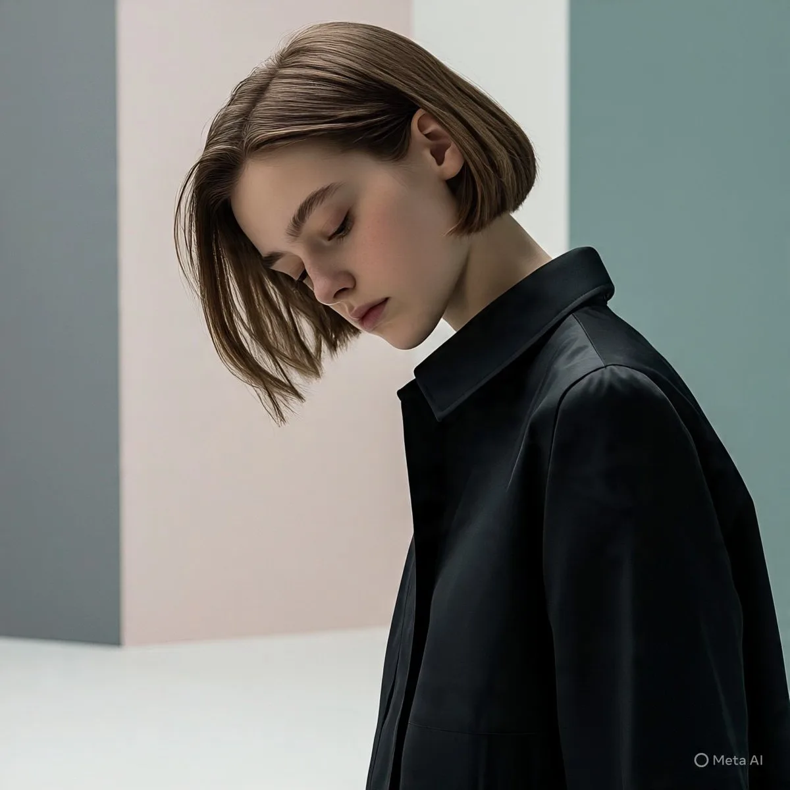

# sadiaamir — by @sadiaamir000786

[← Back to Examples from X](../../EXAMPLES.md) · Category: Photography · Model: `Nano Banana`

<a href="https://x.com/sadiaamir000786/status/2011444902408671530"></a>

Original post: **[@sadiaamir000786 on X](https://x.com/sadiaamir000786/status/2011444902408671530)** · Creator: [sadiaamir](https://x.com/sadiaamir000786)

## Prompt

```text
{
  "image_request": {
    "subject": "Woman",
    "setting": {
      "location": "Parking lot outside a party venue",
      "time_of_day": "Nighttime",
      "lighting": "Direct flash photography with slight motion blur"
    },
    "woman_details": {
      "hair": {
        "description": "Maintains the original length, color, and volume exactly as shown in the reference image",
        "style": "Unchanged from the provided image"
      },
      "facial_features": "Identical to the reference image with no modifications",
      "makeup": {
        "lips": "Subtle glossy finish",
        "general": "Clearly visible makeup"
      },
      "pose": {
        "main_body": "Arms crossed, positioned very close to the camera",
        "hands": "One hand lifted near the face, suggesting an attempt to shield from the camera"
      },
      "expression": "Unfocused and distracted"
    },
    "attire": {
      "top": "White strapless lace corset featuring front hook or clasp closures",
      "bottom": "Light-wash denim low-rise skinny jeans",
      "accessories": {
        "bag": "White shoulder bag",
        "jewelry": [
          "Necklace (kept on)",
          "Bracelet (kept on)"
        ]
      }
    },
    "style_keywords": [
      "Night-out party vibe",
      "Y2K aesthetic",
      "Trendy fashion"
    ],
    "camera_perspective": {
      "distance": "Extremely close range",
      "framing": "Tight close-up",
      "angle": "Straight-on, front-facing"
    },
    "image_specifications": {
      "dimensions": "1200 x 1200 pixels"
    },
    "additional_notes": "Image appears to be captured casually by a friend."
  }
}
```

## Try it

Paste the prompt into **[vinano.ai](https://vinano.ai?utm_source=github&utm_medium=readme&utm_campaign=awesome-image-video-prompts-updating&utm_content=x-page-try)** to generate your own version.

> The image and prompt belong to [@sadiaamir000786](https://x.com/sadiaamir000786) and are shown here with credit for reference. Creators can ask for changes or removal by opening an issue.
