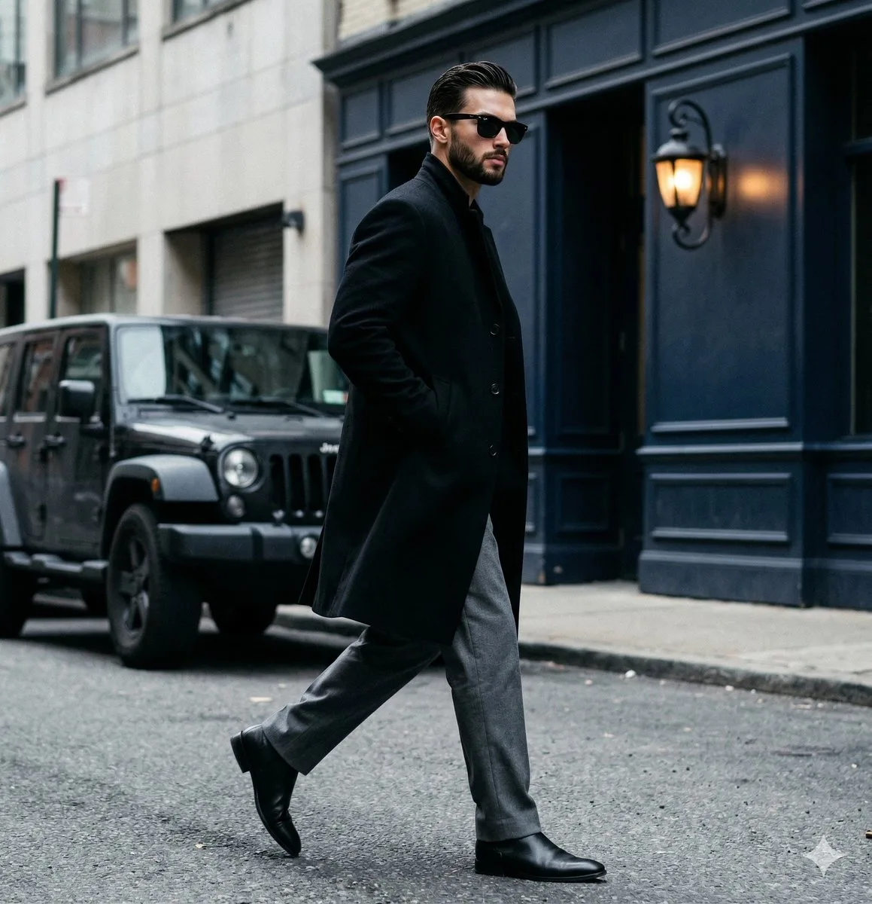

# Picts by AI — by @pictsbyai

[← Back to Examples from X](../../EXAMPLES.md) · Category: Photography · Model: `Nano Banana`

<a href="https://x.com/pictsbyai/status/2039615557272494205"></a>

Original post: **[@pictsbyai on X](https://x.com/pictsbyai/status/2039615557272494205)** · Creator: [Picts by AI](https://x.com/pictsbyai)

## Prompt

```text
{
"metadata": {
"image_type": "photograph",
"primary_purpose": "editorial"
},
"composition": {
"rule_applied": "rule of thirds",
"aspect_ratio": "2:3",
"layout": "layered",
"focal_points": [
"Subject's face and sunglasses",
"Flowing silhouette of the black overcoat"
],
"visual_hierarchy": "Eye starts at the subject's face/sunglasses, travels down the sweeping lines of the black coat to the stride of the grey trousers, then moves back to register the black vehicle and architectural background",
"balance": "asymmetric"
},
"color_profile": {
"dominant_colors": [
{
"color": "Deep Black",
"hex": "#111111",
"percentage": "45%",
"role": "primary subject clothing and vehicle"
},
{
"color": "Slate Grey",
"hex": "#5A5D60",
"percentage": "20%",
"role": "trousers and street surface"
},
{
"color": "Navy Blue",
"hex": "#1C2331",
"percentage": "25%",
"role": "background building facade"
},
{
"color": "Warm Amber",
"hex": "#ECAE62",
"percentage": "2%",
"role": "accent light from sconce"
}
],
"color_palette": "monochromatic with cool bias and a warm accent",
"temperature": "cool",
"saturation": "desaturated",
"contrast": "medium contrast"
},
"lighting": {
"type": "mixed",
"source_count": "multiple sources",
"direction": "diffused from above",
"directionality": "diffused",
"quality": "soft light",
"intensity": "moody",
"contrast_ratio": "medium contrast",
"mood": "dramatic",
"shadows": {
"type": "soft gradual edges",
"density": "gray",
"placement": "under vehicle, beneath subject's coat, under jawline",
"length": "short"
},
"highlights": {
"treatment": "subtle",
"placement": "reflections on sunglasses, leather shoes, car bumper, and subtle sheen on cheekbone"
},
"ambient_fill": "present",
"light_temperature": "cool (blue) with a localized warm (golden) practical light"
},
"technical_specs": {
"medium": "digital photography",
"style": "realistic",
"texture": "smooth",
"sharpness": "slightly soft",
"grain": "film grain",
"depth_of_field": "medium",
"perspective": "straight on"
},
"artistic_elements": {
"genre": "street",
"influences": [
"Paparazzi street style photography",
"High fashion editorial candid shots"
],
"mood": "sophisticated",
"atmosphere": "Cinematic, moody urban transit with a cool, detached, fashionable energy",
"visual_style": "clean"
},
"typography": {
"present": false,
"fonts": [],
"placement": "none",
"integration": "none"
},
"subject_analysis": {
"primary_subject": "A stylish adult male walking briskly in a tailored black overcoat and sunglasses",
"positioning": "center",
"scale": "full",
"interaction": "isolated",
"facial_expression": {
"mouth": "parted slightly open",
"smile_intensity": "no smile",
"eyes": "hidden by sunglasses, appearing to look straightforward",
"eyebrows": "neutral",
"overall_emotion": "serious",
"authenticity": "candid"
},
"hands_and_gestures": {
"left_hand": "hidden entirely inside the left pocket of the overcoat",
"right_hand": "hidden entirely inside the right pocket of the overcoat",
"finger_positions": "not visible",
"finger_interlacing": "none",
"hand_tension": "relaxed",
"interaction": "resting in pockets",
"naturalness": "organic casual gesture"
},
"body_positioning": {
"posture": "walking",
"angle": "facing slightly left of camera in mid-stride",
"weight_distribution": "shifted onto the front right leg",
"shoulders": "level"
},
"hair_analysis": {
"length": "medium-short, approximately 3-4 inches on top, reaching just past the nape of the neck in the back",
"style_name": "slicked back undercut or taper",
"texture": "straight but highly styled, wet-look texture with visible comb tracks",
"imperfections": "some slight flyaway strands visible at the very back edge near the collar, natural separation of hair clumps from product wear",
"part_location": "no distinct part, pushed straight back",
"styling_state": "heavy product use, likely a high-hold pomade or gel giving a glossy, structured hold",
"volume": "low volume, sleek and close to the scalp"
}
},
"background": {
"setting_type": "outdoor urban street",
"spatial_depth": "medium",
"elements_detailed": [
{
"item": "Black Jeep Wrangler (grill, bumper, front tire)",
"position": "left and directly behind subject",
"distance": "midground",
"size": "medium",
"condition": "worn",
"specific_features": "matte black plastic bumper, dirty tire treads, distinct round headlight casing outline"
},
{
"item": "Potted plant (thin-leafed shrub/small tree, possibly oleander or olive)",
"position": "left mid-upper quadrant",
"distance": "background",
"size": "small",
"condition": "thriving",
"specific_features": "housed in a dark planter, thin sprawling branches, small pale green leaves"
},
{
"item": "Wall sconce / lantern",
"position": "top left quadrant",
"distance": "background",
"size": "small",
"condition": "pristine",
"specific_features": "black metal housing, classic trapezoidal shape, emitting warm yellow light"
}
],
"wall_surface": {
"material": "painted wood/masonry facade",
"surface_treatment": "smooth paint with architectural paneling and molding",
"texture": "perfectly smooth",
"finish": "matte",
"color": "dark navy blue",
"color_variation": "uniform",
"features": "clean, horizontal routed lines, framed window with closed horizontal blinds",
"wear_indicators": "pristine"
},
"floor_surface": {
"material": "asphalt street and concrete curb",
"color": "medium slate grey",
"pattern": "solid with slight urban texture/grit"
},
"objects_catalog": "Subject's black overcoat, subject's grey trousers, subject's black leather pointed shoes, subject's black wayfarer sunglasses, black Jeep Wrangler (partial), potted plant, wall sconce, architectural building facade.",
"background_treatment": "slightly blurred to separate subject"
},
"generation_parameters": {
"prompts": [
"A candid paparazzi-style street photography shot of a handsome man walking briskly down an overcast city street. He has slicked-back dark hair, wearing classic black sunglasses, a long flowing black tailored overcoat, and relaxed grey trousers. Both hands are tucked casually into his coat pockets. In the background, there is a black Jeep parked, and a dark navy blue building facade with classic molding and an illuminated warm wall sconce. Shot on 85mm lens, slight film grain, desaturated cool tones, cinematic moody lighting, fashion editorial vibe.",
"A low-angle fashion street style tracking shot of a male model in mid-stride. He wears a heavy black wool trench coat, wide-leg grey dress pants, and dark wayfarer sunglasses. Wet-look slicked back hair. He walks past a dark SUV on a grey asphalt street. The background features a deep blue storefront with a glowing vintage street lamp. Soft overcast lighting, muted color palette, sharp focus on the subject with a slightly soft background."
],
"keywords": [
"street style",
"menswear",
"candid photography",
"black overcoat",
"urban fashion"
],
"technical_settings": "Camera: DSLR or Mirrorless, Lens: 85mm or 105mm, Aperture: f/2.8 or f/4 to achieve medium depth of field, Shutter Speed: 1/500s or faster to freeze walking motion, ISO: 400-800 for overcast lighting and slight grain.",
"post_processing": "Desaturated color grade pulling down greens and warm tones (except for the localized lamp light), crushed blacks for a matte shadow look, added subtle film grain, slight vignette, cool temperature overall white balance shift."
}
}
```

## Try it

Paste the prompt into **[vinano.ai](https://vinano.ai?utm_source=github&utm_medium=readme&utm_campaign=awesome-image-video-prompts-updating&utm_content=x-page-try)** to generate your own version.

> The image and prompt belong to [@pictsbyai](https://x.com/pictsbyai) and are shown here with credit for reference. Creators can ask for changes or removal by opening an issue.
