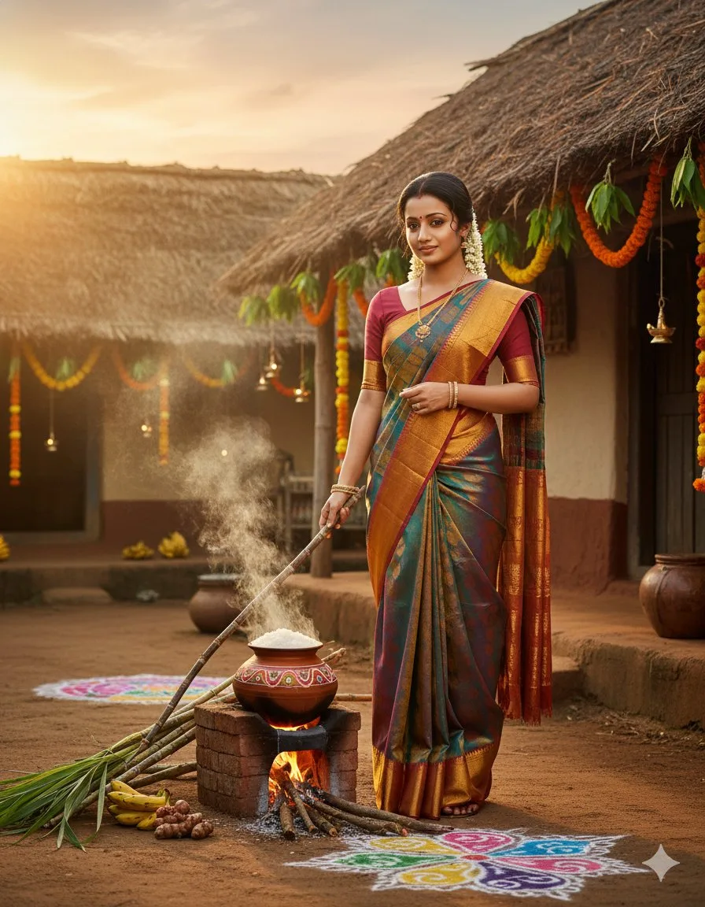

# ராஜேஷ் — by @r4jjesh

[← Back to Community Examples](../../EXAMPLES.md) · Category: Photography · Model: `Nano Banana`

<a href="https://x.com/r4jjesh/status/2011629245949493378"></a>

Source: **[@r4jjesh on X](https://x.com/r4jjesh/status/2011629245949493378)** · Creator: [ராஜேஷ்](https://x.com/r4jjesh)

## Prompt

```text
{
  "prompt": "Using the uploaded reference image, generate a highly realistic full-body portrait of the SAME person with 100% identical facial structure, skin tone, facial proportions, and overall identity. Do NOT alter the face in any way.\n\nA proud South Indian woman celebrating the Thaipongal festival, standing gracefully in a traditional rural Tamil village courtyard at sunrise. She is wearing an elegant traditional silk saree (Kanjivaram-style) in rich festive colors with a gold zari border, draped authentically. A matching blouse complements the saree. Her hair is neatly styled in a traditional manner, adorned with fresh jasmine flowers (mallipoo). A subtle sandalwood or kumkum tilak is visible on her forehead. She holds a long brown leafy sugarcane stalk gently in one hand.\n\nIn the foreground, a decorated clay Pongal pot is boiling over on a wood-fired brick stove, with rice frothing out, symbolizing prosperity. Beside the stove are tied brown sugarcane stalks, fresh turmeric plants, bananas, and intricate colorful kolam (rangoli) designs drawn on the ground.\n\nThe background features a rustic mud house with a thatched roof, decorated with mango-leaf torans, marigold flower garlands, and hanging clay oil lamps. Warm golden sunrise light fills the scene, with soft smoke rising from firewood, creating a joyful and auspicious festive atmosphere.\n\nUltra-realistic cinematic lighting, shallow depth of field, natural South Indian skin texture, authentic Tamil rural aesthetic, 8K ultra-detailed quality, vertical composition, cultural accuracy, festive mood.",
  "style": "cinematic realism, South Indian traditional portrait",
  "lighting": "warm golden sunrise light, soft cinematic glow",
  "environment": "traditional Tamil rural village courtyard",
  "camera": "professional portrait photography, shallow depth of field",
  "quality": "ultra-realistic, 8K, highly detailed",
  "composition": "full-body, vertical frame",
  "constraints": "face must remain 100% identical to the uploaded reference image with absolutely no facial modification"
}
```

## Try it

Paste the prompt into **[vinano.ai](https://vinano.ai?utm_source=github&utm_medium=readme&utm_campaign=awesome-image-video-prompts-updating&utm_content=x-page-try)** to generate your own version.

> The image and prompt belong to @r4jjesh ([original post](https://x.com/r4jjesh/status/2011629245949493378)) and are shown here with credit for reference. Creators can ask for changes or removal by opening an issue.
