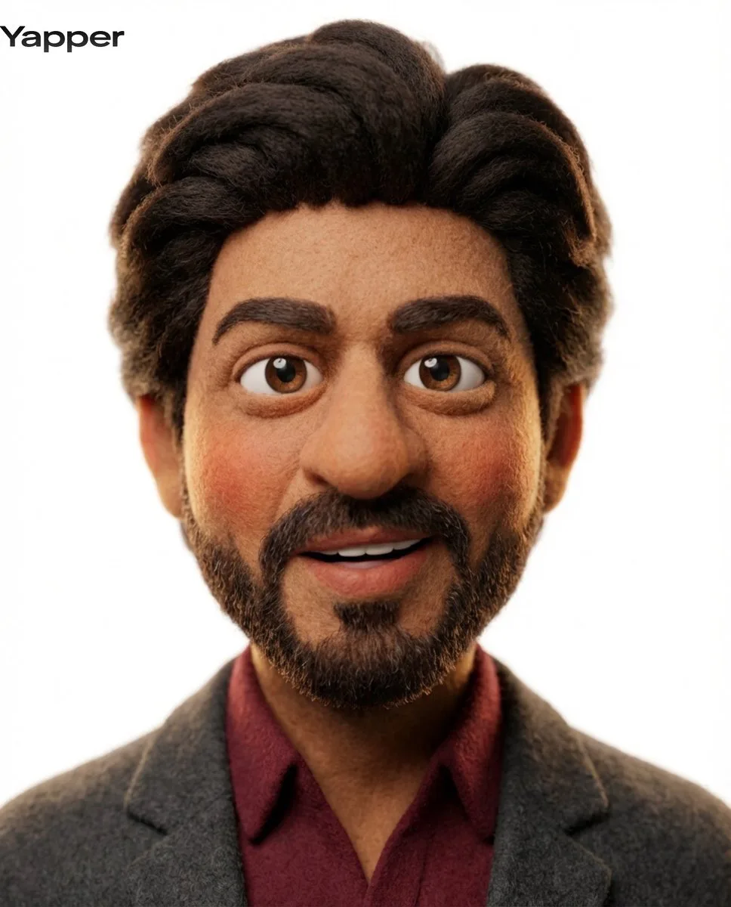

# Professor — by @Professor_134

[← Back to Examples from X](../../EXAMPLES.md) · Category: Illustration & 3D · Model: `Nano Banana`

<a href="https://x.com/Professor_134/status/2026976077072183696"></a>

Original post: **[@Professor_134 on X](https://x.com/Professor_134/status/2026976077072183696)** · Creator: [Professor](https://x.com/Professor_134)

## Prompt

```text
Transform the uploaded image into a stylized 3D claymation character. Soft felt / fuzzy texture skin, rounded exaggerated facial features, big expressive eyes, thick soft eyebrows, slightly oversized nose, warm blush tones on cheeks. Playful open-mouth expression. Clean pure white studio background. Soft diffused studio lighting, subtle rim light, shallow depth of field. Pixar-style charm, stop-motion aesthetic, highly detailed fibers and soft materials, cinematic render, warm vibrant tones.
```

## Try it

Paste the prompt into **[vinano.ai](https://vinano.ai?utm_source=github&utm_medium=readme&utm_campaign=awesome-image-video-prompts-updating&utm_content=x-page-try)** to generate your own version.

> The image and prompt belong to [@Professor_134](https://x.com/Professor_134) and are shown here with credit for reference. Creators can ask for changes or removal by opening an issue.
