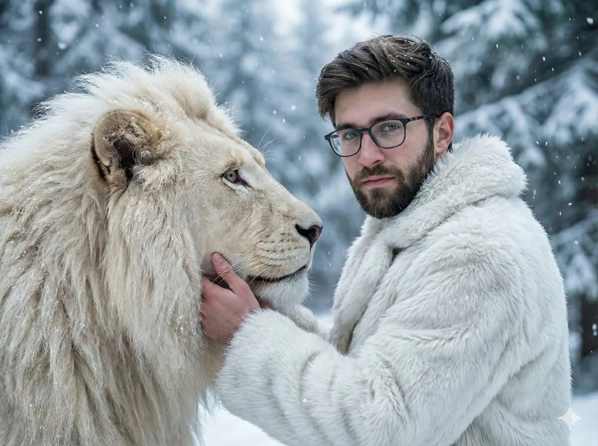

# Duet | AI — by @Sheldon056

[← Back to Examples from X](../../EXAMPLES.md) · Category: Photography · Model: `Nano Banana`

<a href="https://x.com/Sheldon056/status/2011997711479017859"></a>

Original post: **[@Sheldon056 on X](https://x.com/Sheldon056/status/2011997711479017859)** · Creator: [Duet | AI](https://x.com/Sheldon056)

## Prompt

```text
A cinematic ultra-realistic portrait of a man standing face-to-face with a majestic white lion in a snowy forest. The man is wearing a luxurious white fur coat, gently holding the lion’s face with one hand, conveying trust, power, and calm dominance. Soft snowfall surrounds them, with frosted pine trees blurred in the background. Dramatic natural lighting, shallow depth of field, sharp focus on facial details and fur texture. Cold winter color grading, soft whites and muted grays. Hyper-detailed fur, realistic skin texture, emotional eye contact. Shot on a high-end DSLR, 85mm lens, f/1.8, cinematic composition, photorealistic, 8K quality.
```

## Try it

Paste the prompt into **[vinano.ai](https://vinano.ai?utm_source=github&utm_medium=readme&utm_campaign=awesome-image-video-prompts-updating&utm_content=x-page-try)** to generate your own version.

> The image and prompt belong to [@Sheldon056](https://x.com/Sheldon056) and are shown here with credit for reference. Creators can ask for changes or removal by opening an issue.
