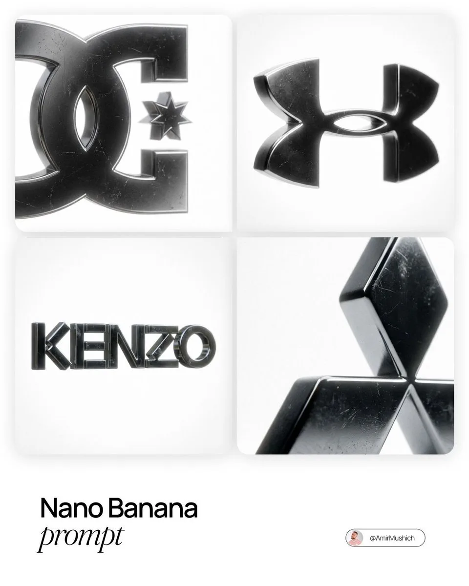

# AmirMušić — by @AmirMushich

[← Back to Examples from X](../../EXAMPLES.md) · Category: Product & Brand · Model: `Nano Banana`

<a href="https://x.com/AmirMushich/status/2012978382812635204"></a>

Original post: **[@AmirMushich on X](https://x.com/AmirMushich/status/2012978382812635204)** · Creator: [AmirMušić](https://x.com/AmirMushich)

## Prompt

```text
[BRAND NAME], the official trademark logo rendered strictly as a solid 3D object, maintaining the exact original vector shape and proportions without any artistic reinterpretation or distortion. The logo is crafted from dark, highly polished chrome metal with subtle surface micro-scratches and imperfections that break the mirror finish. The object is perfectly centered in a vast, infinite pure white void with no visible background elements or studio equipment. The lighting creates a soft, cinematic bloom (halo effect) along the metallic edges. 50mm lens aesthetic with a shallow depth of field gently blurring the furthest points of the object. A pronounced, visible film grain overlay is applied to the entire image.
```

## Try it

Paste the prompt into **[vinano.ai](https://vinano.ai?utm_source=github&utm_medium=readme&utm_campaign=awesome-image-video-prompts-updating&utm_content=x-page-try)** to generate your own version.

> The image and prompt belong to [@AmirMushich](https://x.com/AmirMushich) and are shown here with credit for reference. Creators can ask for changes or removal by opening an issue.
