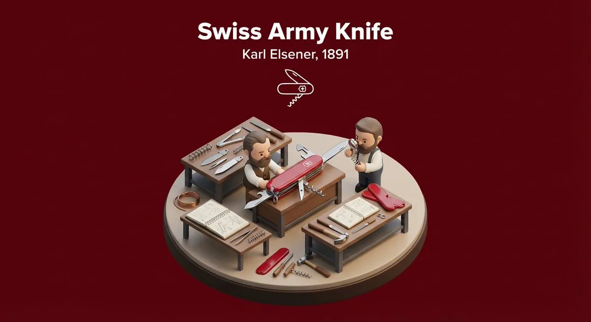

# Aleena Amir — by @aleenaamiir

[← Back to Examples from X](../../EXAMPLES.md) · Category: Illustration & 3D · Model: `Nano Banana`

<a href="https://x.com/aleenaamiir/status/2017449820928282857"></a>

Original post: **[@aleenaamiir on X](https://x.com/aleenaamiir/status/2017449820928282857)** · Creator: [Aleena Amir](https://x.com/aleenaamiir)

## Prompt

```text
Create a miniature 3D isometric diorama showing the invention of [INVENTION NAME] at the moment of [KEY BREAKTHROUGH].

Camera angle around 40° from above.
Textures feel soft and polished. Materials follow realistic PBR rules. Lighting feels natural and balanced.

The raised base includes tools, workshop elements, notes, and early prototypes. Tiny stylized inventors interact with objects. Faces are visible and recognizable with clean shapes and expressions.

Background stays solid [BACKGROUND COLOR].
Top center text shows [INVENTION NAME] in bold.
Second line shows [YEAR OR INVENTOR].
A simple line icon of the invention sits below.
Text color adapts to background contrast.
```

## Try it

Paste the prompt into **[vinano.ai](https://vinano.ai?utm_source=github&utm_medium=readme&utm_campaign=awesome-image-video-prompts-updating&utm_content=x-page-try)** to generate your own version.

> The image and prompt belong to [@aleenaamiir](https://x.com/aleenaamiir) and are shown here with credit for reference. Creators can ask for changes or removal by opening an issue.
