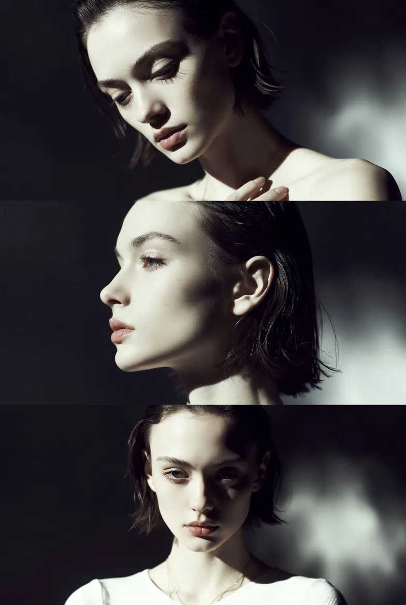

# Cherry 2.O — by @Mind_Boticni

[← Back to Community Examples](../../EXAMPLES.md) · Category: Photography · Model: `Nano Banana`

<a href="https://x.com/Mind_Boticni/status/2023240208700113185"></a>

Source: **[@Mind_Boticni on X](https://x.com/Mind_Boticni/status/2023240208700113185)** · Creator: [Cherry 2.O](https://x.com/Mind_Boticni)

## Prompt

```text
Preserve the face, proportions, and external features of the model as in the reference. A minimalist monochrome fashion editorial triptych featuring three stacked cinematic frames. The subject is a young woman with medium-length dark hair, natural makeup, and elegant features.

Frame 1: Emotional and introspective, looking downward with a hand gently near the collarbone, highlighting cheekbones and bone structure with soft Rembrandt lighting.
Frame 2: A crisp profile shot emphasizing the nose, lips, and graceful jawline, gaze directed slightly upward for a poised, confident look.
Frame 3: A frontal, thoughtful portrait with relaxed shoulders and direct eye contact, conveying quiet strength and elegance.
The composition is clean and modern, using a fitted white top and delicate gold jewelry for visual continuity. Commercial magazine quality, shot on a high-end mirrorless camera, with authentic skin texture, soft bokeh, and cinematic sophistication. Feminine elegance and contemporary fashion sensibility.
```

## Try it

Paste the prompt into **[vinano.ai](https://vinano.ai?utm_source=github&utm_medium=readme&utm_campaign=awesome-image-video-prompts-updating&utm_content=x-page-try)** to generate your own version.

> The image and prompt belong to @Mind_Boticni ([original post](https://x.com/Mind_Boticni/status/2023240208700113185)) and are shown here with credit for reference. Creators can ask for changes or removal by opening an issue.
